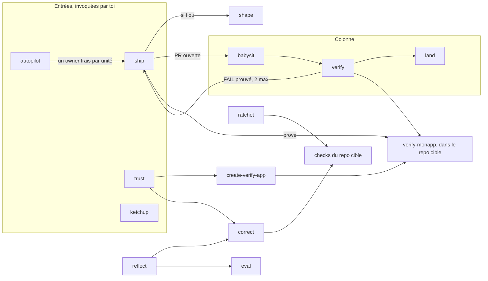

# Architecture 02 — Le framework de skills (v2)

> **Frozen on 2026-11-19.** History only, in French: names, decisions, and paths are those of their time and bind nothing. Decisions in force: [docs/adr/](../adr/). How the framework works today: [skills/README.md](../../skills/README.md).

> **Statut** : v2, validée le 2026-11-17. Aucun skill n'est construit.
> **Version 2** : elle intègre la [revue 03](03-revue-principes.md), qui a confronté la v1 aux grands principes de `knowledge/`, et tes deux décisions :
>
> - l'agent a son propre compte GitHub dès N3 ;
> - le merge sans toi (N4) est un écart assumé, mais repoussé, et débloqué par des preuves.
>
> **Question** : quelle architecture permet de livrer beaucoup de PR, sereinement ?
> **Entrées** : le [brainstorm 01](01-brainstorm-pr-sereines.md), la [revue 03](03-revue-principes.md) et la base [`knowledge/`](../../knowledge/README.md).
> **Reste ouvert** : le repo cobaye (section 14). Sans lui, l'étape 1 ne peut pas commencer.

---

## 1. En une phrase

> **Une colonne unique fait passer chaque changement de l'intention à la PR mergée. Des skills écrivent l'environnement de confiance dans le repo, en commençant par la qualité du code. GitHub arbitre.**

Une formule résume l'autonomie. Sa définition complète, avec les exceptions, est la gate (section 7.3) :

```text
autonomie effective = min(grant que tu donnes, niveau que le repo a mérité pour la classe de risque de la PR)
```

Six choix structurent le reste :

1. **Le codebase d'abord, puis la vérification, puis l'automatisation** (Lauren Tan). Le niveau d'un repo se gagne aussi par la qualité de son code, pas seulement par le nombre de PR.
2. **La confiance vit dans le repo et dans la forge, pas dans les skills.** Chaque promesse a un check. Un agent qui ignore son skill ne peut toujours pas merger ce que la gate refuse.
3. **Un verdict se mérite.** Le vérificateur est calibré, et on prouve qu'il sait échouer : on mesure les défauts qu'il attrape, pas l'absence de FAIL.
4. **Commencer petit.** Le catalogue est un plafond d'hypothèses, pas un plan de construction. Un skill n'entre que quand le même échec est vu deux fois (pstack, guide 09 : « Start smaller than you think »).
5. **Le routage par chemin**, repris de pstack. Le modèle ne choisit jamais un nœud interne sur sa description, et on vérifie dans les transcripts qu'il lit bien les nœuds.
6. **Aucun serveur.** GitHub, la CI et le harnais fournissent l'inbox, les timers, la mémoire et les permissions. Ce qui doit être déterministe, comme le dispatch des unités, est un script, pas un agent.

## 2. Vue d'ensemble

```text
                 TOI : un grant (/ship, /ship send, /autopilot…)
                  │                           ▲  ketchup : ce qui attend ta décision
┌─────────────────▼───────────────────────────┴────────────────────────┐
│ ENTRÉES       ship · autopilot · trust · ketchup (invoquées par toi) │
│ FAÇONNAGE     shape : grill, prototype, architect, plan (si flou)    │
│ COLONNE       ship (frame, build, clean, prove, open-pr)             │
│               → babysit → verify → land                              │
│ KIT           create-verify-app · correct · ratchet                  │
│ MÉTA          reflect · eval (et prune) · lint des skills (script)   │
│ CONSTITUTION  principes, glossaire, preuve, autonomie, harnais       │
└──────────────────┬────────────────────────────────┬──────────────────┘
                   │ écrit et lit                   │ fait respecter
                   ▼                                ▼
     REPO CIBLE                               GITHUB
     .trust/ : politique, risque, règles      statuts trust/verdict, trust/gate
     skill verify-<app>, feature map          protection de branche, CODEOWNERS
     lints, types, tests                      PR, issues, labels : l'état
```

- Tu donnes un **grant** : jusqu'où l'agent peut aller sur cette tâche. Le repo a un **niveau** par classe de risque : ce qu'il a mérité. Le plus petit des deux s'applique.
- Les **entrées** ne s'invoquent qu'à la main : le modèle ne peut pas s'accorder un grant. Toutes déroulent la même **colonne**.
- Le **kit** écrit dans le repo cible ce qui rend la colonne fiable : le skill de vérification, les checks, les règles. Le **méta** transforme les échecs en structure et teste chaque changement de skill.
- **GitHub** a le dernier mot : statuts requis, protection de branche, CODEOWNERS.

## 3. Les douze invariants

Ils tiennent à toutes les étapes de la construction.

1. **Tout changement passe par la colonne**, y compris ceux du kit et du framework. Une seule exception : si la colonne elle-même est cassée, tu la répares par une PR manuelle.
2. **Autonomie effective = min(grant, niveau).** Aucun skill ne peut l'élever.
3. **L'auteur n'est jamais le juge.** Le vérificateur est un agent frais, sans droit d'écriture, et calibré. Pour merger sans toi, il doit venir d'une autre famille de modèle.
4. **Un verdict couvre un patch, constaté à une SHA.** Un push qui change le patch exige un nouveau verdict ; un rebase pur le conserve (règle `patch-id` de pstack). La CI tourne sur chaque SHA.
5. **Chaque promesse a un enforcer.** Une règle sans check est une répétition à corriger tout de suite, pas une simple faiblesse (pstack `correct`). La table de la section 7.5 liste les enforcers de nos propres promesses.
6. **Le grant et la barre sont des actes humains.** Seul toi invoques une entrée qui donne un grant, poses le label de grant ou réécris un `done_when` déjà fixé.
7. **Monter d'un niveau passe par toi**, avec une PR de promotion chiffrée. **Descendre est automatique** (revert, bug échappé).
8. **Chaque boucle a un budget**, compté par la gate ou par l'adaptateur du harnais, jamais par l'agent. À épuisement, le run teste sa prémisse, replanifie une fois, puis s'arrête sur un résumé et une recommandation. Il n'attend pas : ta réponse lancera un nouveau run.
9. **L'état vit dans GitHub et dans `.trust/`.** Jamais dans une base, jamais dans la seule mémoire d'un agent, ni dans un fichier gitignoré.
10. **Chaque étape est idempotente.** Elle lit l'état existant dans GitHub et n'applique que la différence, où que le run précédent se soit arrêté.
11. **Chaque skill déclare son hypothèse** et peut être supprimé.
12. **Les gates, la politique et le framework ne changent que par une PR que tu approuves**, même en N5.

## 4. Les skills

### 4.1 La règle de découpage

Une étape devient un skill si elle remplit au moins une de ces conditions :

- **on l'appelle seule** : « babysit la PR 42 », « vérifie la PR 42 » ;
- **plusieurs appelants la réutilisent** ;
- **un autre rôle l'exécute** : le vérificateur.

Sinon, c'est une section d'un skill existant. Donc :

- `frame`, `build`, `clean`, `prove` et `open-pr` sont des sections de `ship`, leur seul appelant ;
- `prune` est un mode d'`eval` (le même A/B, avec et sans le skill) ;
- `orchestrate` est le mode « programme » d'`autopilot` : la même racine, avec des sous-coordinateurs.

Chaque nœud a une responsabilité vérifiable, et chaque arête du graphe porte sa condition. Le lint vérifie les deux.

### 4.2 Le catalogue : 14 skills au plus

C'est un **plafond**. Les skills des étapes 4 à 6 n'entrent que si la règle des deux échecs les déclenche.

| Famille | Skill | Ce qu'il fait | Étape |
|---|---|---|---|
| Référence | `constitution` | index des principes, glossaire, standard de preuve, autonomie, rôles, adaptateurs de harnais, format de PR | 0 |
| Entrée | `ship` | une intention → une PR. Sections `frame`, `build` (playbooks), `clean`, `prove`, `open-pr` | 1 |
| Entrée | `trust` | `audit` (fondations du code et niveau), `setup` (installe `.trust/`, la CI, les templates), `promote` | 1 |
| Entrée | `ketchup` | en lecture seule : ce qui a mergé, ce qui attend ta décision, avec une section *Attention* écrite par une autre famille | 4 |
| Entrée | `autopilot` | la nuit : une racine qui n'écrit pas de code et un owner frais par unité. Mode `program` pour les chantiers de plusieurs jours | 4 |
| Colonne | `babysit` | conflits, puis reviews, puis CI ; triage sceptique, fixes groupés et reprouvés | 1 |
| Colonne | `verify` | rôle vérificateur : un verdict indépendant sur le patch de tête | 2 |
| Colonne | `land` | merge de bas en haut quand c'est permis, restack, relecture de l'état mergé | 1 |
| Façonnage | `shape` | `grill`, `prototype`, `architect`, `plan` : d'une intention floue à des tranches verticales | si besoin |
| Kit | `create-verify-app` | crée, prouve de bout en bout, puis maintient chaque jour le skill `verify-<app>` du repo | 2 |
| Kit | `correct` | transforme une correction en check, prouvé sur l'erreur réelle ; trouve aussi les classes d'erreurs dans l'historique | 1 |
| Kit | `ratchet` | une PR par jour qui sort un fichier de la liste d'exceptions d'une règle stricte, et le corrige | 2 |
| Méta | `reflect` | retro, d'abord sur les PR en échec et `needs-human`, puis une PR mergée sur dix | 3 |
| Méta | `eval` | A/B aveugle d'un changement de skill, de bout en bout ; mode `prune` | 3 |

Plus un script dès l'étape 0, `lint_skills.py`. `graph.py` et un `install.py` multi-harnais n'arrivent que quand ils servent (section 10.2).

### 4.3 Le graphe

Aperçu dessiné à la main. `constitution`, lue par toutes les entrées et par chaque brief de délégué, est omise pour la lisibilité.



## 5. La colonne

```text
frame ─► build ─► clean ─► prove ─► open-pr ─► babysit ─► verify ─► land ─► mergée
  │        ▲                                     │   ▲      │         │
  │        └───────── FAIL prouvé (≤ 2) ─────────┼───┼──────┘         └─► sinon : arrêt à merge-ready
  │                                              └───┘ conflits, reviews, CI (≤ 5 rounds)
  └─► shape, si « fini quand » n'est pas vérifiable
```

Les cinq premières étapes sont des sections de `ship` ; `babysit`, `verify` et `land` sont des skills.

| Étape | Passe à la suite quand | Budget | Sinon |
|---|---|---|---|
| `frame` | « fini quand » est vérifiable, tiré de la source de l'intention, et validé (par ton « go » en `/ship`) | — | `shape`, ou une question |
| `build` | chaque obligation de preuve du playbook est tenue, ou sautée avec sa raison | 3 tentatives | `needs-human` |
| `clean` | deslop fait ; commentaires relus par un agent qui ne les a pas écrits ; checks du repo verts | — | retour à `build` |
| `prove` | chaque changement du diff a une preuve observée et rejouable | compte dans `build` | retour à `build` |
| `open-pr` | le check `evidence` passe | — | — |
| `babysit` | aucun conflit, threads résolus, aucun « changes requested », CI verte, chaque fix reprouvé | 5 rounds | `needs-human` |
| `verify` | un verdict est posé sur le patch de tête | 2 FAIL | `needs-human` |
| `land` | le merge est relu sur la branche cible, ou la PR attend, merge-ready | — | — |

`needs-human` est un label, plus une entrée dans `ketchup`. Avant de le poser, le run nomme la prémisse que ses essais partageaient, la teste et replanifie une fois. Une PR est **merge-ready** quand il ne lui manque que ta décision.

### 5.1 Règles

- **`frame` reformule d'abord** : objectif, problème, plus petit changement, « fini quand », hors périmètre, classe de risque probable, et autonomie effective annoncée.
  - `done_when` vient de la source de l'intention : l'issue d'origine ou ton message. L'auteur ne fixe pas la barre de son propre juge.
  - En `medium` et `high`, le vérificateur valide `done_when` avant `build`.
  - `frame` marque les zones difficiles pour le modèle (concurrence, synchronisation, perte de données) : les lanes du vérificateur s'y approfondissent.
- **`build` choisit un playbook** selon l'intention : `bug-fix` et `feature` d'abord ; `refactor`, `perf` et `migration` par la règle de croissance.
  - Un playbook énonce des **obligations de preuve**, pas une recette pas à pas. Par exemple : pour un bug, le test qui échoue est un commit séparé, avant le fix.
- **`clean` garde le jardin propre.** Le prochain agent copiera ce qu'on laisse (Lauren Tan) : on retire le slop, on fait relire les commentaires par un agent qui ne les a pas écrits, et ce qui se répète part dans `correct`.
- **Le même builder porte la PR de `frame` à `land`**, fixes de review compris, car il garde le contexte. C'est un écart assumé : Ray Amjad mesure « better » et 38 % moins cher sur ~10 PR, alors que Matt Pocock et pstack prennent un agent frais à chaque round. **Le premier eval de l'étape 3 tranche.** `babysit` fait résumer les logs de CI par un script, pour protéger le contexte.
- **La preuve est rejouable et se proportionne au risque**, mais n'est jamais vide. Une PR de docs prouve son rendu ; une PR d'authentification prouve chaque chemin touché.
- **La review ne fait pas grossir la PR** : ce qui sort du cas visé devient une issue, jamais un fix dans la PR ni un FAIL.
- **Une unité, une PR étroite.** On empile une PR seulement sur une PR dont elle dépend.
- **La voie légère** : une PR `low` (typo, doc, test seul) saute `frame` et ne garde qu'une preuve courte. Son surcoût se mesure dès l'étape 1.
- **Hors colonne** : les questions en lecture seule (« explique ce module ») et le déploiement.

### 5.2 Le format de PR

Le check `evidence` vérifie ce format. Le corps se lit en moins d'une minute (pstack `technical-writing`).

```markdown
<titre qui dit pourquoi, pas quoi>

## Why        le problème, en une ou deux phrases
## Proof      avant / après, et la commande pour rejouer la preuve
## Risk       la classe (low, medium, high), ce qui pourrait casser
              Door: two-way | one-way  (one-way : ton approbation est requise)
## Decisions  si besoin : les choix faits sans toi
## Not verified  ce qui n'a pas pu être prouvé
Created with <modèle> in <harnais> (+ modèles des sous-agents, jamais devinés)
```

Les captures passent une recherche de secrets avant publication. Elles vont en artefacts de CI ou sur une branche orpheline `trust-evidence`, et la PR les lie.

## 6. L'autonomie

### 6.1 Ce que tu donnes : le grant

| Tu tapes | Plafond demandé |
|---|---|
| `/ship <tâche>` | merge-ready : la PR est prête, tu décides du merge |
| `/ship send <tâche>` | merge, si la gate l'autorise |
| `/autopilot <file>` | l'un ou l'autre, à préciser, appliqué à chaque PR |

Le grant inclut la permission de lancer les tests et les outils dont la preuve a besoin, sans redemander. Seul toi poses le label `trust/grant:send`, et la gate vérifie qu'il vient de ton identité.

Ta décision de merger n'est pas un grant :

- en N1 et N2, tu cliques sur merge, ou tu dis « land 41 42 » ;
- à partir de N3, tu approuves les PR sur GitHub, et `land` les merge de bas en haut.

### 6.2 Ce que le repo a mérité : le niveau

| Niveau | Plafond | La gate exige en plus | Entrées permises | Pour y entrer (seuils de départ) |
|---|---|---|---|---|
| N0 | — | — | la conversation | — |
| N1 | merge-ready | `evidence`, CI et checks de review verts | `ship` | `trust setup` fait ; `trust audit` a mesuré les fondations du code |
| N2 | merge-ready | un verdict PASS sur le patch de tête | `ship`, déclencheurs bridés (`ratchet`, `reflect`) | `verify-<app>` prouvé de bout en bout ; vérificateur calibré |
| N3 | merge-ready | idem N2, plus ton approbation sur le patch de tête | + `autopilot` | ~20 PR en N2 sans bug échappé ; échecs répétés convertis en checks (aucune règle faible) ; compte séparé pour l'agent ; trois journaux de run relus par toi |
| N4 | merge | verdict PASS d'une autre famille ; classe ≠ `high` ; porte réversible ; ni `.trust/` ni `.github/` touchés ; kill switch ouvert | + merge sans toi | écart assumé, débloqué par la section 6.4 |
| N5 | merge | idem N4 | + déclencheurs qui mergent | N4 stable ; budgets et throttles en place |

Les niveaux sont par classe : `docs` peut être en N4 pendant que `auth` reste en N2. N3 reste l'ambition à trois mois.

**La règle de blocage** (pstack) : seul un problème démontré bloque, par une exécution qui échoue sur la tête ou par une doc rendue fausse. PASS+NOTES vaut donc PASS, et ses notes deviennent des issues.

### 6.3 Les pauses, à tous les niveaux

L'agent s'arrête et te remet la décision pour :

- tout merge de classe `high`, ou dont la porte est irréversible (`Door: one-way`) ;
- tout changement de `.trust/`, de `.github/` ou du framework ;
- un force-push sur une branche partagée, un déploiement, une suppression de données, un message à un client ;
- un conflit avec une autre unité : zone modifiée par un autre owner, ou `done_when` contradictoires. Le run s'arrête et ne revert jamais le travail d'autrui ;
- une décision produit qu'aucune expérience ne tranche.

Quand tu es là (`ship`), la question passe par l'outil de question du harnais, avec le contexte, les options et une recommandation. Un message normal passerait inaperçu (tstack). Quand tu es absent (`autopilot`) :

- le run applique un défaut sûr et le rapporte, en disant ce que tu aurais pu demander à la place ;
- il pose `trust/decision-pending`, et la gate refuse alors tout merge sans toi ;
- il laisse la PR ouverte et non mergée, puis passe à l'unité suivante.

### 6.4 Monter, descendre, couper

- **Promotion** : `/trust promote` ouvre une PR qui modifie `policy.yml`, avec les chiffres de la classe et leur taille d'échantillon. Tu l'approuves ou non.
- **Le merge sans toi (N4) est un écart assumé.** Matt Pocock et pstack gardent toujours un humain avant le merge ; Lauren Tan auto-merge, mais après six mois d'environnement. On l'assume, sous trois conditions :
  1. le vérificateur est calibré, et il attrape au moins 80 % des défauts semés dans sa classe (seuil de départ) ;
  2. la classe a l'échantillon qui prouve son taux de revert : ~300 PR sans revert pour prouver moins de 1 %, ou ~100 pour moins de 3 % ;
  3. la gate est durcie (section 7.4).

  On commence par `docs` et `tests`, où une erreur coûte presque rien.
- **Rétrogradation** : dès qu'une PR auto-mergée d'une classe est revertée, ou qu'un bug échappé est étiqueté `escaped`, la gate plafonne cette classe à N3. Le plafond tient jusqu'à la prochaine PR de promotion.
- **Kill switch** : la variable de repo `TRUST_AUTOMERGE=off` coupe tout auto-merge, immédiatement. Seul un admin la change, et l'agent ne l'est pas.

## 7. Le kit de confiance, le vérificateur et la gate

### 7.1 Ce que `/trust setup` installe dans le repo cible

```text
.trust/
├── policy.yml        niveaux par classe, budgets, indépendance du vérificateur, lanes
├── risk.yml          classes de risque, par chemins et par taille
├── rules.md          table règle → enforcer, tenue par correct
└── bin/              gate.py, risk.py, evidence.py, stats.py, et leurs tests
.claude/skills/
└── verify-<app>/     le skill de vérification du repo, écrit par create-verify-app
.github/
├── workflows/trust.yml          jobs evidence, risk et gate
├── pull_request_template.md
└── CODEOWNERS                   toi, sur .trust/ et .github/
CODING_STANDARDS.md              les standards de jugement, lus par la lane standards
```

Les scripts sont copiés avec leur numéro de version. `/trust audit` fait deux choses :
- il mesure les fondations du code (lint, types, frontières, tests, règles faibles) et la version des scripts ;
- il recommande les réglages de protection de branche, sans les appliquer : c'est une action d'admin, donc la tienne.

### 7.2 Politique et risque

`policy.yml` au départ, source unique de chaque valeur :

```yaml
version: 1
levels:                      # niveau mérité par classe ; seule une PR de promotion le change
  low: 1
  medium: 1
  high: 1
budgets:
  build_attempts: 3
  babysit_rounds: 5
  verify_fails: 2
  run_max_usd: 30            # plafond d'une nuit, appliqué par l'adaptateur
verifier_independence:       # la seule règle sur la famille du vérificateur
  merge_with_you: any-fresh-agent
  merge_without_you: other-family
roles:                       # famille et gamme, jamais une version
  builder: claude-opus
  verifier: gpt
lanes:                       # ce que fait le vérificateur, par classe
  low: [replay-proof, live, standards]
  medium: [replay-proof, live, standards, code-review, risk-probe]
  high: [replay-proof, live, standards, code-review, risk-probe, design-review]
```

Toutes les classes ont une lane `live` : le vérificateur pilote l'app réelle et compare base et tête. Il ne se contente pas de rejouer la preuve du builder. Une lane `formal` s'ajoute en `high` si la règle de croissance la réclame (concurrence, retries, parseurs).

`risk.yml` ; la première règle qui correspond gagne :

```yaml
- class: high
  any_path: [".github/**", ".trust/**", "**/migrations/**", "**/auth/**"]
- class: high
  changed_lines_over: 400
- class: low
  all_paths: ["docs/**", "**/*.md", "**/*.test.*"]
- class: medium            # tout le reste
```

Une PR est `high` dès qu'un seul fichier sensible est touché, et `low` seulement si tous ses fichiers sont anodins.

### 7.3 Le vérificateur

Un vérificateur qu'on ne règle pas trouve les défauts, puis valide quand même. Anthropic le dit : « Out of the box, Claude is a poor QA agent ». Ce que design/02 exige donc :

- **Il tourne sans droit d'écriture**, dans un contexte frais, et lit `constitution` et le glossaire du repo.
- **Il est calibré par des exemples** : des verdicts tirés de vraies PR, sur lesquels tu as tranché.
  - Règle : un défaut constaté reste un FAIL, sauf si `done_when` l'exclut.
- **Un FAIL est prouvé** : il porte la commande, la sortie observée et la sortie attendue. Sans exécution, c'est une NOTE.
  - Barème repris de tstack : un blocker ou un should donne FAIL ; un nit donne NOTE.
  - Le builder peut contester un FAIL avec des preuves. Si le désaccord persiste, la PR passe en `needs-human` avec les deux positions.
- **Il rend un verdict par axe** : comportement (lanes `replay-proof`, `live`, `risk-probe`) et code (`standards`, `code-review`). Un bon axe ne masque pas l'autre.
- **On mesure qu'il sait échouer.** `evals/verdicts/` contient des défauts semés et des bugs échappés rejoués, par classe.
  - On allège les lanes d'une classe selon le taux de défauts **attrapés**, jamais selon l'absence de FAIL.

Le verdict a deux formes :
- un statut de commit `trust/verdict` : `success` pour PASS, `failure` pour FAIL, `error` pour INCONCLUSIVE ;
- un commentaire au format fixe.

La gate lit l'**auteur** du statut, jamais le texte du commentaire.

```text
trust-verdict: PASS sha=3f2a9c1 patch-id=8be04d7 lanes=replay-proof,live,standards,code-review,risk-probe
behaviour: PASS   code: PASS
- note : le même motif de double envoi existe dans « Dupliquer » → issue #57
```

### 7.4 La gate

La gate est un job de CI qui pose le statut requis `trust/gate`. Elle obéit à trois règles :
- elle ne lit que des métadonnées (statuts et leurs auteurs, reviews, threads, labels et qui les a posés, fichiers modifiés, historique des reverts) ;
- elle n'exécute jamais le code de la PR ;
- elle lit `policy.yml` et `risk.yml` sur la branche de base : une PR ne peut pas se reclasser elle-même.

```text
gate(pr) :
  exiger   evidence vert, CI verte, threads résolus, aucun « changes requested »,
           branche à jour, sur la SHA de tête
  exiger   statuts trust/verdict en échec < budgets.verify_fails ; sinon poser needs-human
  classe ← risk(pr)
  niveau ← policy.levels[classe], plafonné à 3 si la classe est rétrogradée
  si niveau ≥ 2 :
      exiger un verdict PASS, posé par un vérificateur frais, dont le patch-id = celui de la tête
  si niveau = 3, ou classe = high, ou Door = one-way, ou trust/decision-pending :
      exiger ton approbation, dont le patch-id = celui de la tête
  → trust/gate vert : la PR peut merger

  merge sans toi, seulement si :
      niveau ≥ 4  et  verdict PASS d'une autre famille que l'auteur
      et  classe ≠ high  et  Door = two-way  et  ni .trust/ ni .github/ touchés
      et  label trust/grant:send posé par toi  et  TRUST_AUTOMERGE ≠ off
```

On laisse désactivé le réglage GitHub qui révoque les approbations à chaque push : c'est la gate qui vérifie que le patch approuvé est bien celui de la tête. Une pile se rebase donc sans te redemander quoi que ce soit, mais du code nouveau redemande ton approbation.

### 7.5 Nos promesses et leurs enforcers

| Promesse | Enforcer |
|---|---|
| le vérificateur ne corrige jamais | il tourne sans droit d'écriture |
| les budgets | la gate compte les verdicts en échec ; l'adaptateur compte tentatives, rounds et dollars |
| le plafond merge-ready en N1 et N2 | un hook du harnais bloque `gh pr merge`, `--auto` et la merge queue sous N4 |
| merge-ready à partir de N3 | le compte de l'agent ne peut pas approuver ses PR ; la règle « une approbation requise » l'empêche de merger |
| le grant est un acte humain | entrées invocables par toi seul ; label vérifié par la gate |
| « reviews traitées » | la gate exige des threads résolus et aucun « changes requested » |
| un fix de skill vit dans sa propre PR | la CI du framework refuse une PR qui mêle `skills/**` et d'autres fichiers |
| le modèle lit les nœuds par chemin | `eval` vérifie dans les transcripts que les nœuds attendus ont été lus |
| aucune action d'administration | hook testé (contournements par options globales de git compris), en mode fermé ; compte de l'agent sans droits d'admin dès N3 |

### 7.6 Identités et modèle de menace

Deux menaces :
- **un agent pressé qui contourne** : il pose lui-même un statut, merge, ou modifie le workflow qui le juge ;
- **des entrées non fiables** : sur un repo public, une issue ou un commentaire peut contenir une injection de prompt.

| Niveau | Qui merge | Ce qui protège |
|---|---|---|
| N1–N2 | toi, présent | les statuts requis empêchent l'oubli ; le hook bloque merge, `--auto` et administration, puisque l'agent agit sous ton nom |
| N3 | `land`, après ton approbation | l'agent a son propre compte (compte machine, sans droits d'admin, jeton minimal). Il ne peut pas approuver ses PR, et la règle « une approbation requise » l'empêche de merger seul. Tu peux enfin approuver ses PR |
| N4–N5 | `land`, sur l'approbation de la gate | la gate approuve sous une identité que les branches de PR n'atteignent pas : définition de workflow de la branche de base, secret limité à la branche par défaut. La protection de branche exige `trust/gate` de cette source. Le vérificateur des classes auto-mergées tourne hors de portée du builder (job CI ou agent cloud) |

Contre les entrées non fiables :
- seule une issue labellisée par toi entre dans la file d'`autopilot` ;
- `babysit` traite les commentaires comme des données, jamais comme des consignes.

Les mécanismes GitHub exacts restent à valider sur ton plan, dans une ADR : à l'étape 4 pour le compte machine, à l'étape 5 pour l'identité de la gate.

## 8. L'état, les nuits et le graphe du travail

### 8.1 Où vit chaque chose

| État | Où | Écrit par |
|---|---|---|
| Niveaux, budgets, rôles | `.trust/policy.yml` | toi, par PR |
| Classes de risque | `.trust/risk.yml` | toi, par PR |
| Règles et leurs enforcers | `.trust/rules.md` | `correct`, par PR |
| Unités de travail, dépendances, réservation | issues GitHub (assignation = réservation) | `shape`, `autopilot`, toi |
| Pourquoi, preuve, risque, décisions | la PR | `ship`, `babysit` |
| Verdict | statut `trust/verdict` et commentaire | `verify` |
| Feu vert de merge | statut `trust/gate` | la gate |
| Journal de décisions d'un run | artefact du run et résumé en commentaire sur la PR | le propriétaire du run |
| Corrections reçues | issues labellisées `correction` | l'agent corrigé ; `correct` les consomme |
| Métriques | calculées depuis GitHub par `stats.py` | `trust audit`, `ketchup` |
| Préférences personnelles | config du harnais (`CLAUDE.md`, `AGENTS.md`) | toi |

Aucun registre n'est tenu à la main dans le repo, et rien d'important n'est gitignoré. Le journal de décisions reprend les colonnes de pstack : heure, phase, décision, raison, pointeur de preuve, résultat.

### 8.2 Les nuits : `autopilot`

Repris de pstack `autopilot-full` : « You own the verdicts, never the PRs ».

- **Une racine qui n'écrit jamais de code.** Elle lance les owners et les vérificateurs, lit les verdicts et tient le trail. Un tick horaire juge chaque owner sur ses poussées, pas sur son texte. Un stop devient un ordre de zéro écriture.
- **Un owner frais par unité**, qui porte sa PR avec `ship`. Les owners tournent en parallèle depuis trunk ; on n'empile que sur une dépendance. Chaque run a son worktree.
- **Le dispatch est déterministe.** Un script calcule la frontière (les unités dont toutes les dépendances sont mergées) et réserve les issues. Aucun agent ne prend ces décisions (Matt, `implement-spec`).
- **Les ressources partagées sont partitionnées** :
  - branches nommées d'après l'unité (`u/U3-double-save`) ;
  - un seul watcher par PR ;
  - appels à GitHub et à la CI bridés ;
  - un budget en dollars par run.
- **Reprise** : un run tué au milieu reprend depuis l'état GitHub (invariant 10). Ta réponse sur une PR `needs-human` relance un run via le watcher de PR.
- **Le matin** : `ketchup` est en lecture seule. Il fait deux choses :
  - il audite le trail contre le transcript (pstack `show-me-your-work`) ;
  - il donne la section *Attention*, écrite par une autre famille, qui permet de décider à partir de sa seule réponse.
- **Le mode `program`**, pour un chantier de plusieurs jours, ajoute des sous-coordinateurs : environ dix owners en vol par coordinateur, trois niveaux au plus.

### 8.3 Le graphe du travail

Une issue par unité ; les issues sont liées par « blocked by #n ». Le contrat d'une unité, en tête d'issue :

```yaml
id: U3
goal: "Un double clic sur Enregistrer ne crée qu'une note"
done_when: "le test e2e double-clic passe ; une seule note en base"   # doit échouer sur le commit de base
out_of_scope: ["le bouton Dupliquer"]
touches: ["src/editor/**"]
depends_on: [U1]
```

Règles :

- **des tranches verticales** (tracer bullets), chacune démontrable seule, et tenant dans une fenêtre de contexte fraîche (Matt `to-tickets`). Le découpage se valide avec toi ;
- **deux unités en parallèle ne partagent aucun chemin de `touches`**, et un fichier partagé (registre, type commun) devient une arête du graphe. Ce script est notre ajout : pstack orchestre sans script ;
- **le parallèle est réservé au travail indépendant par nature** : bugs par zone, docs, ratchet. Un spec couplé reste à un seul owner, en pile ;
- **une unité de bout en bout avant d'éventer**, pour qu'un défaut du brief coûte un agent, pas cinquante (pstack) ;
- **relance selon la cause** : périmètre réduit après une limite de contexte, même brief après une coupure, autre modèle après une erreur d'outil. Après deux relances, l'unité est abandonnée et on replanifie.

## 9. Modèles et harnais

### 9.1 Les rôles

| Rôle | Ce qu'il fait | Famille par défaut |
|---|---|---|
| builder (owner) | porte une PR de `frame` à `land` | Claude, gamme haute |
| verifier | juge un patch, sans droit d'écriture | GPT, via Codex |
| racine | lance, supervise et juge les runs de nuit ; n'écrit pas de code | Claude, gamme haute |

Les rôles `worker` (gamme rapide) et `panel` (plusieurs familles sur une décision d'architecture) n'existent que s'ils gagnent un eval contre la version sans eux. Le panel recueille les avis séparément, puis écrit noir sur blanc les désaccords (Anthropic, *multiagent*).

Sans autre famille disponible, le vérificateur reste un agent frais, mais la classe ne peut pas dépasser N3 (voir `verifier_independence`). Des agents d'une même famille se trompent ensemble : l'exigence d'une autre famille est un pari, qu'on mesure.

### 9.2 Les adaptateurs de harnais

Les skills nomment des capacités, jamais des outils. `constitution/references/harness.md` les traduit :

| Capacité | T3 Code | Claude Code seul | Codex |
|---|---|---|---|
| lancer un sous-agent d'une autre famille | `delegate_task` | CLI de l'autre famille (à préciser) | à préciser |
| garantir un contexte frais | sous-agent neuf | sous-agent neuf | à préciser (Codex peut forker le contexte parent) |
| isoler un run | worktree | worktree | worktree |
| être réveillé par une PR | `watch_pull_request` | `pr-wait` porté sous Windows, ou repli REST | idem |
| planifier une tâche | `schedule_task` | `CronCreate` | cron système ou CI |
| poser une question | `AskUserQuestion` | `AskUserQuestion` | `request_user_input` |
| plafonner le coût d'un run | à préciser | à préciser | à préciser |

Note : le `pr-wait` de tstack ne tourne pas tel quel sur ton poste (`fcntl` est absent sous Windows).

## 10. Le format des skills et la méta-couche

### 10.1 Un nœud

Le frontmatter suit la spec Agent Skills. Les arêtes du graphe vivent dans `metadata`. Exemple pour `verify` :

```yaml
---
name: verify
description: "Gives an independent verdict on a pull request's head patch, without editing code."
disable-model-invocation: true
metadata:
  kind: spine
  role: verifier
  calls: "verify-app"
  consumes: "pr, head-sha, done-when"
  produces: "trust/verdict status, verdict comment"
  enforced-by: "trust/gate requires a verdict authored by a fresh verifier on the head patch"
  budget: "policy.yml#budgets.verify_fails"
  hypothesis: "An author model checks what it meant to build, not what it built."
---
```

Règles d'écriture :

- **Les descriptions ne nomment aucun autre skill.** Le graphe vit dans `metadata`, pas dans la prose.
- **`metadata` renvoie à `policy.yml`** au lieu de recopier une valeur.
- **Les entrées qui portent un grant sont invocables par toi seul.** Les nœuds internes ne sont jamais choisis par le modèle sur leur description. `install.py` traduit ce réglage pour chaque harnais ; pour Codex, l'équivalent de `allow_implicit_invocation: false` est à vérifier.
- **Seules les étapes sont obligatoires, chacune avec son critère de fin.** Un skill de pure référence, comme `constitution`, n'en a pas (Matt `writing-for-agents`).
- **Un `SKILL.md` vise moins de 800 mots.** Au-delà, le lint avertit sans bloquer. Le détail va dans `references/`, le mécanique dans `scripts/`.
- **La prose suit `technical-writing` et `unslop` (pstack).** Leur partie mécanique (mots bannis, phrases trop longues) est dans le lint.
- **La section `Reply` nomme chaque principe appliqué**, avec la décision qu'il a changée (pstack `poteto-mode`).
- **Les skills sont en anglais** ; la constitution impose de te répondre dans ta langue. Les docs de conception restent en français.

### 10.2 Les scripts du framework

| Script | Étape | Rôle | Échoue si |
|---|---|---|---|
| `tools/lint_skills.py` | 0 | frontmatter, étapes et critères, liens, mots bannis, termes du glossaire à éviter ; avertit sur le budget de mots | champ manquant, étape sans critère, lien cassé, terme à éviter |
| `tools/graph.py` | 3 | génère le graphe depuis `metadata.calls` | nœud orphelin, lecture d'un skill sans arête déclarée, arête sans condition, cycle sans budget |
| `tools/install.py` | 1 (Claude), puis par harnais | installe les skills et traduit les champs propres à chaque harnais | — |

`graph.py` partira de [`knowledge/tools/build_skill_catalog.py`](../../knowledge/tools/build_skill_catalog.py).

### 10.3 La méta-boucle

- **`correct` dès l'étape 1.** Sans argument, il trouve les classes d'erreurs dans l'historique du cobaye. Il préfère, dans l'ordre : l'architecture, les types, un lint dont le message nomme le fix, un test, et la doc en dernier.
  - Chaque nouveau check est prouvé sur l'erreur réelle qui l'a motivé.
  - Ce qui relève du jugement va dans `CODING_STANDARDS.md`, lu par la lane `standards`.
- **`reflect`** commence par les PR en FAIL et en `needs-human`, puis prend une PR mergée sur dix (Matt). Elle range chaque cause dans une case :
  - le code → `correct` ;
  - un skill → une PR de skill et `eval` ;
  - l'environnement → `create-verify-app` ou `trust`.
- **`eval`** compare deux versions d'un skill à l'aveugle, de bout en bout, sur les PR réelles de l'étape 1 (`evals/e2e/`).
  - Un juge d'une autre famille, deux runs par cas.
  - On lit les cas qui basculent, pas seulement le score.
  - Le mode `prune` compare avec et sans le skill. Il tourne dès l'étape 3, puis à chaque nouveau modèle.
- **Règle de croissance** : un skill ou un check naît quand le même échec apparaît deux fois.
- **Un skill cassé se répare dans sa propre PR**, jamais au milieu d'une tâche (pstack, guide 09). Un run de fix qui échoue ne déclenche rien (Matt) : il attend ta revue.

### 10.4 Le glossaire

`constitution/references/glossary.md` est une table FR→EN, avec les termes à éviter (repris de Matt). Il définit :

- grant, niveau, classe de risque ;
- verdict, lane, merge-ready, `needs-human` ;
- porte (door), racine, owner, unité, frontière.

Il tranche aussi le vocabulaire en concurrence : « issue tracker » (glossaire de Matt) plutôt que « ticket tracker » (`software-factory`) ; « niveau » N0–N5 plutôt que l'« autonomy level » 0–3 de la synthèse 06. Le builder et le vérificateur lisent aussi le glossaire du repo cible.

## 11. L'arborescence du framework

```text
software-ai-skills-framework/
├── knowledge/               base de connaissance
├── design/                  brainstorm, architecture, revue, puis decisions/ (ADR)
├── skills/
│   ├── constitution/        SKILL.md et references/ : principles, glossary, proof, autonomy, harness, pr-format
│   ├── ship/                SKILL.md (frame, build, clean, prove, open-pr) et playbooks/ : bug-fix, feature
│   ├── trust/               SKILL.md, assets/ (gabarits), scripts/ (gate, risk, evidence, stats, tests)
│   ├── babysit/  verify/  land/  correct/
│   └── …                    les autres skills, quand la règle de croissance les déclenche
├── tools/                   lint_skills.py et ses tests ; graph.py et install.py plus tard
├── evals/                   e2e/ (PR réelles), verdicts/ (défauts semés), résultats des A/B
└── .github/workflows/       CI du framework : lint, tests des scripts, PR de skill isolées
```

Le framework est aussi un repo cible : `/trust setup` s'y applique, et ses propres PR passent par la colonne.

## 12. Un exemple de bout en bout

`/ship send le bouton Enregistrer crée parfois deux notes`, sur un repo où `medium` est en N2 :

1. **frame** : « Bug : un double clic sur Enregistrer crée deux notes. Fini quand : un test e2e double-clic passe et une seule note existe en base. Hors périmètre : Dupliquer. Classe probable : `medium`, en N2. Tu as dit send, mais je m'arrêterai à merge-ready. Go ? » Tu réponds « go ». Le vérificateur valide `done_when`.
2. **build** (playbook `bug-fix`) : un commit avec le test qui échoue, puis le fix.
3. **clean** : deslop. Un commentaire qui justifiait un contournement est retiré.
4. **prove** : `verify-notes` lance l'app, double-clique et capture l'écran avant et après.
5. **open-pr** : titre « Empêcher le double enregistrement d'une note ». Why, Proof (avant/après, commande à rejouer), Risk (`medium`, `Door: two-way`). `evidence` passe.
6. **babysit** : un bot signale un cas limite hors périmètre. Il devient l'issue #58, pas un fix. Les threads sont résolus et la CI est verte.
7. **verify** : un agent GPT frais, sans droit d'écriture, rejoue la preuve et pilote l'app sur base et tête. Il relit le code. Verdict : comportement PASS, code PASS, une note qui devient l'issue #57.
8. **land** : la gate est verte, mais le plafond est merge-ready. La PR attend.

Ton temps : dire « go », puis lire Why, Proof et le verdict, survoler le diff et merger. Environ deux minutes.

**De nuit, en N3** : `/autopilot label:nuit` sur six issues que tu as labellisées.
- Le script calcule la frontière.
- La racine lance quatre owners en parallèle depuis trunk, et deux en pile sur leur dépendance.
- Au matin, `ketchup` montre cinq PR merge-ready avec PASS, et une PR `needs-human` : prémisse testée, replanifiée, puis deux FAIL prouvés, avec sa recommandation.
- Tu approuves les cinq ; `land` les merge et relit chaque merge.

Objectif : moins de 15 minutes.

## 13. Hors périmètre

- **Serveur, base de données, file de messages** : GitHub et le harnais suffisent jusqu'à preuve du contraire.
- **Personas** (testeur, PM, designer) : ils ne marchent pas « right now » (Ray Amjad). À réessayer avec un eval quand les modèles changent.
- **Des essaims pour construire** : la coordination n'émerge pas d'agents qui discutent (Anthropic, *multiagent*) ; elle vient du graphe du travail.
- **Un mode monolithique épinglé** : des entrées courtes, des principes indexés et lus à la demande.
- **La dépendance à un harnais** : les capacités passent par l'adaptateur.
- **Le déploiement** : le framework s'arrête à la PR mergée.

## 14. Décisions prises et hypothèses restantes

| Question | Statut | Choix |
|---|---|---|
| Compte séparé pour l'agent | **décidé** (2026-11-17) | dès N3 ; en N1 et N2, ton compte et le hook |
| Merge sans toi (N4) | **décidé** (2026-11-17) | écart assumé, repoussé, débloqué par la section 6.4 ; `docs` et `tests` d'abord |
| Ambition à trois mois | **décidé** | N3 |
| Repo cobaye | **ouvert, bloquant** | sans lui, ni preuve ni mesure. Une lib ou une CLI se prouve par des commandes plutôt que par des captures |
| Autre famille de modèles | hypothèse | GPT via T3 Code. Sans elle, plafond N3 |
| Harnais | hypothèse | T3 Code, avec Claude Code |
| Forge | hypothèse | GitHub, repo public ou plan payant. Sur un repo privé gratuit, pas de protection de branche ; le hook, contournable, est la seule barrière, donc plafond N2 |

## 15. La feuille de route

Chaque étape se termine sur une preuve, pas sur une date.

| Étape | On construit | Preuve de sortie |
|---|---|---|
| 0 · Fondations | `constitution` (index des principes, glossaire), `lint_skills.py` | lint vert en CI sur `constitution` |
| 1 · N1 | `ship` (`frame`, `build` avec `bug-fix` et `feature`, `clean`, `prove`, `open-pr`), `babysit`, `land`, `trust` (`audit`, `setup`), `correct`, `install.py` pour Claude Code, le hook | 10 vraies PR sur le cobaye, avec des preuves que tu as rejouées ; au moins une classe d'erreurs de l'historique convertie en check ; attention par PR et surcoût de la voie légère mesurés ; ces PR forment `evals/e2e/` |
| 2 · N2 | `create-verify-app` (prouvé de bout en bout, maintenance quotidienne), `verify` (calibré), `evals/verdicts/`, gate v1, `ratchet` bridé | 20 PR avec verdict ; le vérificateur attrape au moins 80 % des défauts semés ; aucun bug échappé |
| 3 · Méta | `reflect`, `eval` (de bout en bout, `prune`), `graph.py` | au moins 3 classes d'erreurs devenues des checks prouvés ; la tension « même builder ou agent frais » tranchée par eval ; un `prune` passé |
| 4 · N3 | `autopilot` (racine, owners, dispatch par script), `ketchup`, compte machine, journaux durables, budgets en dollars ; `shape` si besoin | une nuit : au moins 5 PR merge-ready avec verdict ; audit du matin en moins de 15 min ; un run tué au milieu converge à la relance ; aucune action interdite tentée |
| 5 · N4 | gate durcie avec son identité, vérificateur hors de portée du builder, auto-merge de `docs` et `tests`, rétrogradation, kill switch | les conditions de la section 6.4 tenues sur leur échantillon ; kill switch testé |
| 6 · N5 | déclencheurs qui mergent, mode `program` d'`autopilot` | deux semaines de boucle externe sous throttle ; un chantier multi-PR livré, une unité de bout en bout d'abord |

**Premier jalon utile** : l'étape 1, soit cinq skills, la constitution et le hook. **Le framework apprend seul à partir de l'étape 3.**

## 16. Pourquoi cette architecture

| Alternative | Ce qu'elle fait bien | Pourquoi pas comme ça |
|---|---|---|
| pstack (`poteto-mode`) | un mode complet : un index par chemin, des playbooks, des principes, un eval à l'aveugle | lié à Cursor (agents cloud, slugs de modèles) ; pas d'échelle mesurée par repo et par classe de risque. On reprend son routage par chemin, sa règle de blocage, sa racine et son patch-id |
| Matt Pocock | des skills petits et composables, un flux principal, des contrats, une factory avec des freins | il garde volontairement un humain avant chaque merge, et ne possède pas le processus. On reprend ses freins, son façonnage, ses règles d'écriture et son glossaire |
| tstack | portable, excellent sur la PR | ni échelle, ni kit, ni méta. On reprend sa gate « full confidence », son barème et ses règles de PR |
| Un moteur maison (blueprint 04) | le contrôle total | on construirait la plateforme au lieu de livrer des PR |

Notre apport : une échelle de confiance mesurée par repo et par classe, qui commence par la qualité du code, avec GitHub comme arbitre.

**Les risques de cette architecture** :

- **La sécurité de N3 et N4 repose sur des réglages GitHub** non encore vérifiés sur ton plan. Les ADR des étapes 4 et 5 les valideront.
- **La vérification coûte des tokens.** Le vérificateur ne s'allège que sur la preuve qu'il attrape encore les défauts semés.
- **Les seuils sont des valeurs de départ** (80 % de défauts semés, 20 PR, l'échantillon de N4). On les recalibre sur nos données.
- **Plusieurs capacités de harnais sont à préciser** : contexte frais garanti sous Codex, plafond de coût, `pr-wait` sous Windows.

## 17. Ce qu'il faut pour avancer

1. **Le repo cobaye** : quel projet réel, et quelle stack ?
2. Ensuite, l'étape 0 : `constitution` et `lint_skills.py`.
