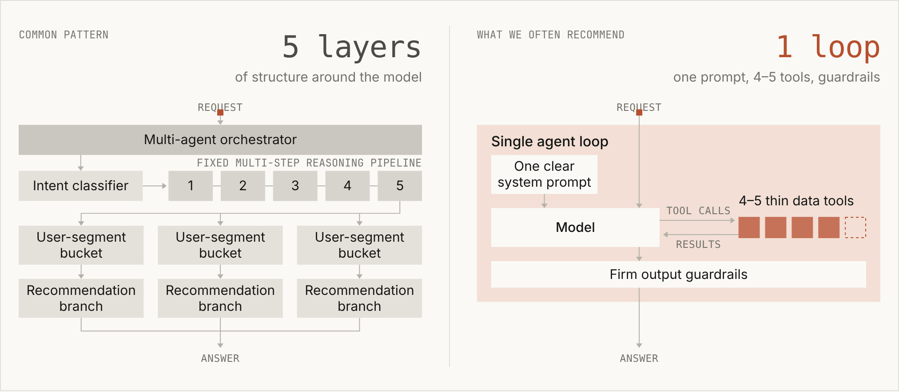
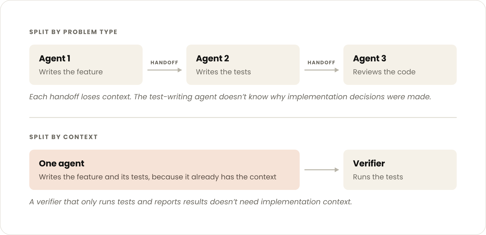
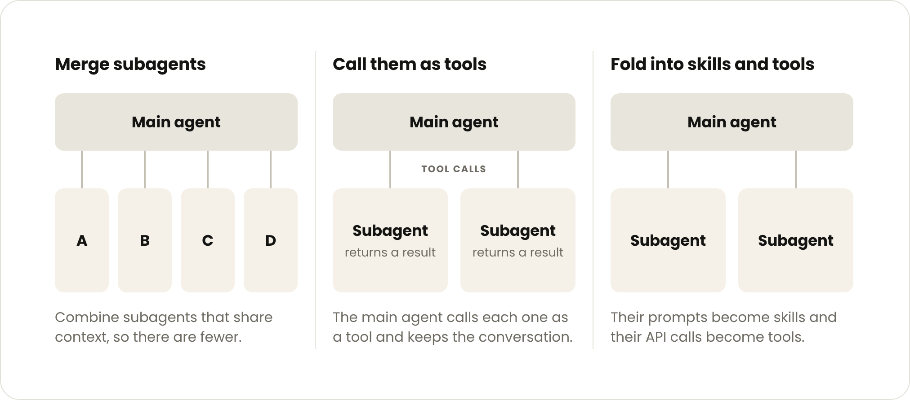

# Nectar — When to fold subagents into your main agent loop

> **Thèse en une phrase** : avec les modèles actuels, **un seul agent, un seul contexte, des skills et des outils chargés à la demande** bat souvent une architecture d'orchestrateur et de spécialistes ; on ne garde un sous-agent que s'il est **découpé par contexte**, pas par type de problème, et si une eval prouve qu'il fait mieux.

**Source** : Diane Sarkis, Anthropic, 2026-10-22 · [article](https://claude.com/fr/resources/articles/building-agents-when-to-fold-subagents-into-your-main-agent-loop) · [contenu hors-ligne](content.md)

---

## 1. Le constat : l'architecture copie l'organigramme

Les entreprises donnent un sous-agent à chaque équipe ou type de problème. L'architecture devient une copie de l'organigramme (loi de Conway).

Modes d'échec :

| Échec | Symptôme |
|---|---|
| **Gestion du contexte** | Il faut décider quoi échanger ; les détails se perdent dans les allers-retours. |
| **Prolifération** | Des centaines de sous-agents qui se chevauchent, sans standard ni propriétaire. |
| **Frankenprompt** | Chaque équipe ajoute une phrase ; règles contradictoires, pas de voix unique. |
| **Evals locales** | Chacun optimise sa sous-tâche ; personne ne tient l'ensemble. |
| **Latence** | Un client a mesuré une boucle unique ~2x plus rapide. |

Souvent, toute la structure (classifieur d'intention, pipeline fixe, branches, orchestrateur) faisait un travail dont le modèle n'a plus besoin : **un prompt clair, 4-5 outils fins, des garde-fous de sortie fermes** suffisent.

**Pour notre framework** : c'est exactement notre choix n°2 et n°5 de design/02 (« le moins de nœuds possible », « conçu pour rétrécir »). Chaque skill doit justifier son existence contre la boucle nue.

---

## 2. Quand un sous-agent reste justifié

Trois conditions seulement :

1. la boucle unique **se dégrade de façon mesurable** à cause du gonflement du contexte ;
2. plusieurs tâches doivent tourner **en parallèle**, avec des contextes frais **jetables** ;
3. l'agent unique **choisit mal ses outils** ou son prompt contient des **instructions contradictoires**.

Et la règle de découpe : **diviser par contexte**. Un sous-agent reçoit un travail qui demande peu au reste du système et rend un résultat compact. Bons candidats : pistes de recherche indépendantes, composants à interfaces propres, **vérification boîte noire**. Diviser par type de problème produit un « téléphone arabe ».

**Pour notre framework** :

- **Confirme** le **vérificateur frais** (invariant 3) : la vérification boîte noire est l'exemple canonique de découpe par contexte. Il reçoit un patch, rend un verdict compact, et ne doit surtout pas hériter du contexte du builder.
- **Confirme** l'orchestration à ~10 workers : unités indépendantes, contextes jetables (condition 2), à condition que chaque unité soit vraiment autonome et rende un résultat compact.
- **Confirme** « le même builder porte une PR de `frame` à `land` » : c'est la boucle unique de l'article. Le contexte accumulé (pourquoi ce choix, quel test a cassé) sert à `babysit` et aux corrections ; un relais entre agents le perdrait.

---

## 3. La boucle unique cible

- Un modèle, un contexte, une boucle d'outils ouverte ; **budgets (tours, coût) et write gates dans le harnais**.
- À chaque tour : un lot d'appels d'outils en parallèle, résultats bruts rendus au même modèle.
- Arrêt quand le modèle répond ou épuise son budget ; **une vérification peut tourner après la réponse**.
- **Le modèle qui écrit le plan l'exécute**, et le révise en cours de route.
- Répartition :
  - ordre et procédure de domaine → **skills** ;
  - limites dures (validation, gates d'approbation), lookups → **outils** ;
  - mécanique déterministe et peu coûteuse → **code** dans les outils.

Trois raisons : le contexte partagé produit de meilleures réponses ; la divulgation progressive évite le gonflement ; les modèles récents vérifient et narrent leur travail, ce qui rend une partie du harnais redondante.

**Pour notre framework** :

- **Confirme** invariant 7 (budget par boucle) et invariant 5 (chaque promesse a un enforcer) : les gates vivent dans les outils et la forge, pas dans la prose des skills.
- **Confirme** la séparation planifier/exécuter **dans le même agent** : `shape`/`plan` puis `build` par le même builder. Un planificateur séparé qui passe un plan figé serait un anti-pattern.
- **Nuance** : l'article dit que les règles dures doivent vivre dans les **outils**, qui renvoient un refus lisible. Nos préconditions de nœud (« pas de `open-pr` sans preuve ») gagneraient à être des **scripts qui refusent**, pas seulement des instructions.

---

## 4. Migrer pas à pas, piloté par les evals

1. **Eval de bout en bout d'abord** : 10 exemples dorés suffisent. Un jeu central, plus de petits jeux livrés avec chaque skill.
2. Mesurer le **routage** (bon sous-agent ? puis bon skill / bon outil ?) et viser la **complétion de tâche**.
3. **Fusionner** les spécialistes couplés (qui s'enchaînent, touchent les mêmes données).
4. Étape intermédiaire : **sous-agent appelé comme outil**, avec un schéma de réponse partagé. Handoff complet seulement s'il doit parler à l'utilisateur.
5. **Replier un sous-agent à la fois** (prompt → skill, API → outil MCP), comparer avec et sans.
6. Regarder **quelles tâches ont basculé**, pas seulement le score. Lancer chaque tâche **plusieurs fois** : une régression n'apparaissait qu'une fois sur deux.

**Pour notre framework** : c'est le contrat de `eval` et `eval --prune`. Il faut :

- une eval de bout en bout de la colonne (une intention → une PR mergée) **avant** de découper ou fusionner des nœuds ;
- des evals de routage pour les entrées (bonne entrée invoquée ?) ;
- des runs répétés (au moins 2-3) avant de déclarer une régression absente ;
- le diff des **tâches basculées** dans le rapport d'eval.

---

## 5. Plusieurs contributeurs, un seul agent

| Brique | Quand | Règle |
|---|---|---|
| **Outils MCP** | action, donnée vivante, résultat de forme fixe | grouper par intention ; au-delà de 30-50 outils, le choix se dégrade ; tool search différé |
| **Skills** | comment l'équipe travaille : étapes, règles, jugement | un DRI par skill ; evals livrées avec ; élaguer le poids mort |
| **Bases de connaissance** | référence utile parfois | derrière un outil de recherche ou en fichiers de référence d'un skill |

Une petite équipe centrale possède le prompt système et la qualité de bout en bout, et valide tout nouvel outil, skill ou eval.

**Pour notre framework** : notre méta-couche (`reflect`, `eval`, `lint`) joue ce rôle d'équipe centrale, et invariant 10 (tout changement de framework passe par une PR approuvée) en est l'enforcer. Le routage par chemin (choix n°3) contourne le problème de sélection d'outils : seules les entrées exposent une description.

---

## 6. Ce qui confirme et ce qui challenge design/02

### Confirme

- Builder unique de bout en bout ; plan et exécution dans le même contexte.
- Vérificateur séparé, frais : vérification boîte noire = bonne découpe par contexte.
- Workers parallèles à contexte jetable pour des unités indépendantes.
- Budgets et gates dans le harnais et la forge.
- « Conçu pour rétrécir » : chaque nouveau modèle retire du harnais ; `prompt-audit` ≈ notre déclaration d'hypothèse par skill.

### Challenge

1. **Le coordinateur et ses workers risquent le « téléphone arabe ».** Si les unités de `orchestrate` sont découpées par type (tests, docs, refacto du même module) au lieu de par contexte, les résumés rendus sont lossy. Règle à ajouter : une unité n'est confiée à un worker que si elle tient seule et rend un résultat compact ; sinon elle reste au builder.
2. **Le rôle `worker` (gamme rapide) et le `panel` multi-familles doivent gagner leur place par eval**, pas par principe. L'article recommande de garder un sous-agent seulement si la version repliée fait pire.
3. **Le vérificateur d'une autre famille n'est pas justifié par l'article** : Anthropic justifie la séparation par le contexte, pas par la famille de modèle. Notre exigence de deux familles reste un pari d'indépendance à mesurer (taux de défauts attrapés en plus), pas un acquis.
4. **17 skills dans le catalogue** : pas un problème tant que seules les entrées sont exposées, mais chaque nœud interne lu par chemin est une petite « Frankenprompt » potentielle. `lint` doit détecter les règles contradictoires entre nœuds.
5. **Les gates doivent être dans les outils.** Là où design/02 décrit une précondition en prose dans un skill, préférer un script qui refuse avec un message actionnable.

---

## 7. Citations à garder

> « Use them when: a single agent loop hits measurable performance degradation from context bloat, or multiple tasks need to be tackled in parallel with fresh context windows that can be discarded once the task is done, or a single agent struggles to select appropriate tools. »

> « Decompose boundaries effectively by dividing by context: give each subagent a piece of work that needs little from the rest of the system and have it hand back a compact result. »

> « The model that writes the plan is also the one carrying it out, so it can change the plan mid-turn. »

> « Run each task more than once, since a break like this one only showed up in one run out of two. »

> « Build a small end-to-end eval, fold in one subagent, and keep it as a subagent only if the folded version scores worse, then rinse and repeat. »
