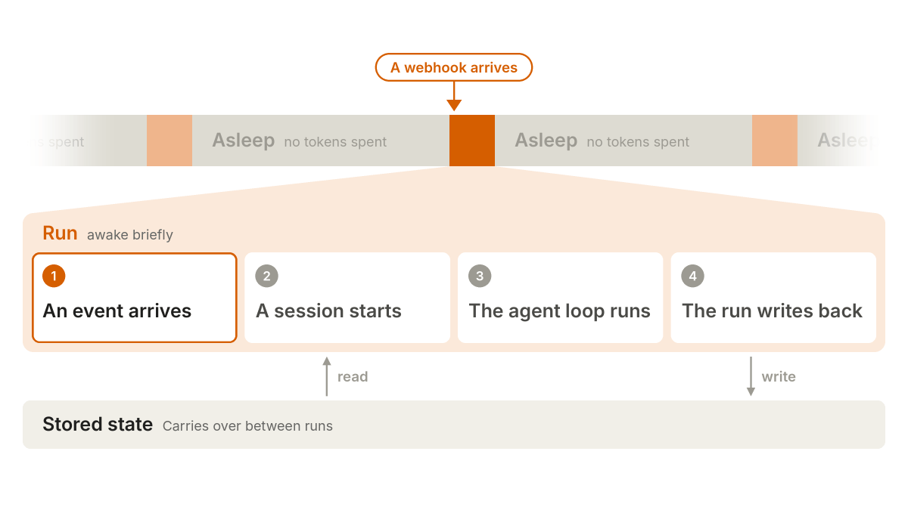
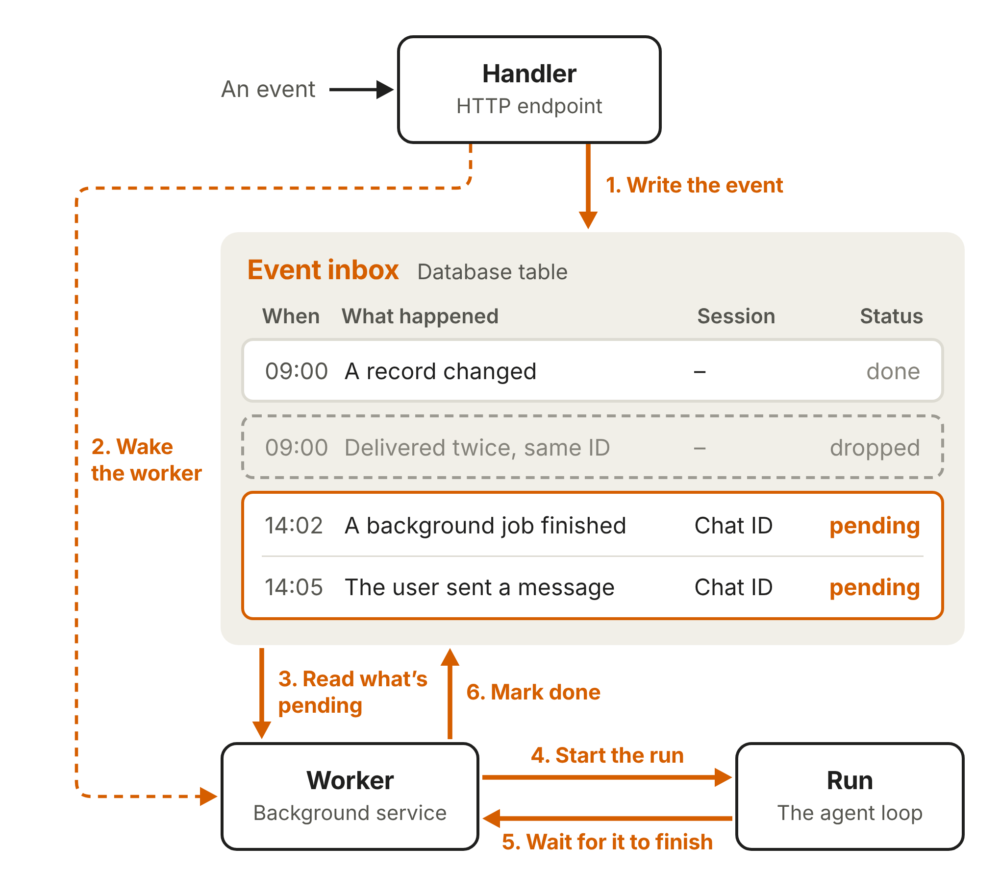
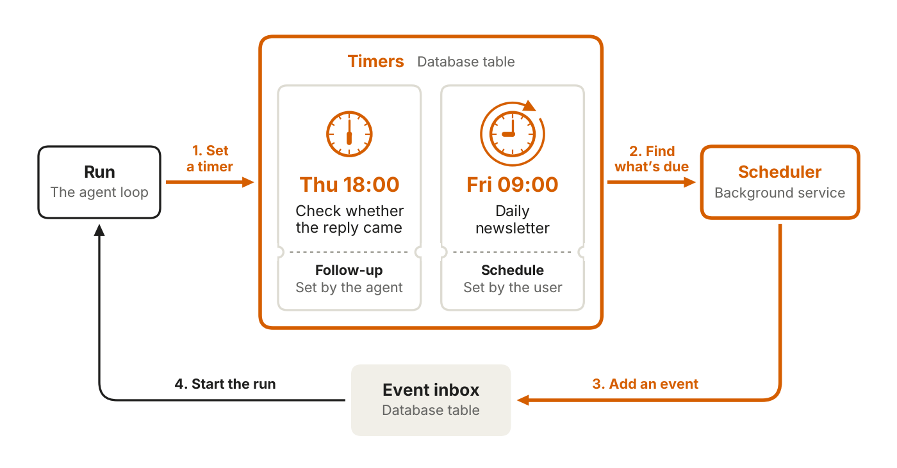
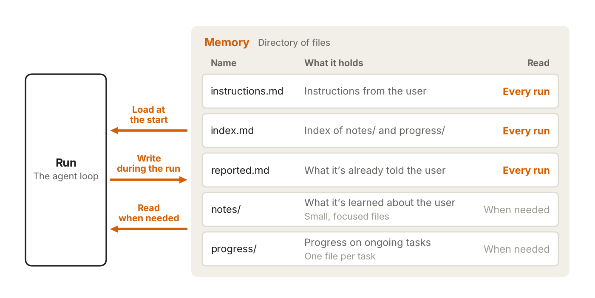
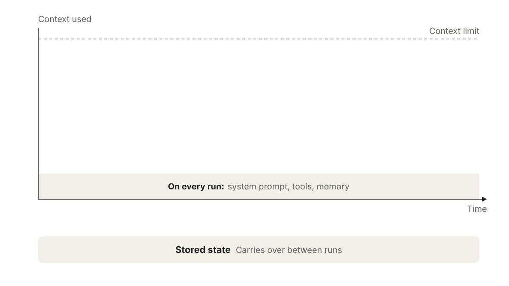
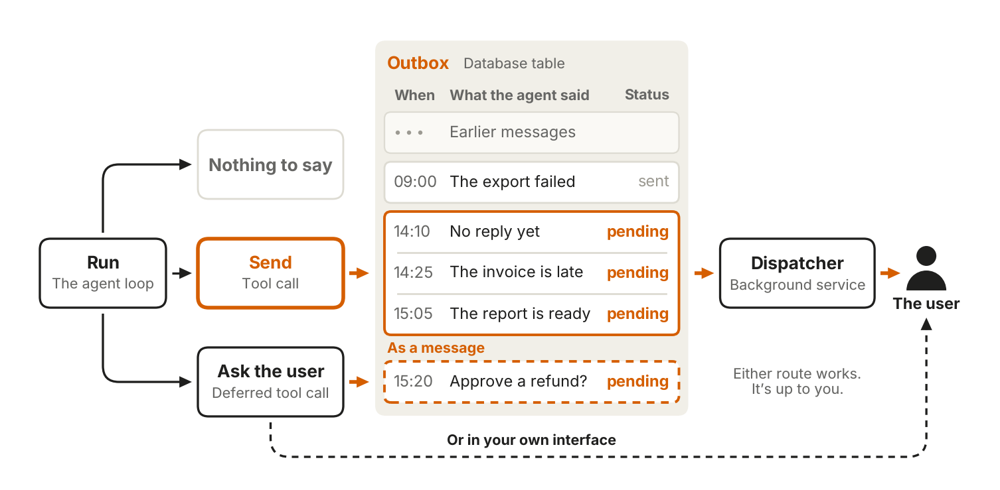
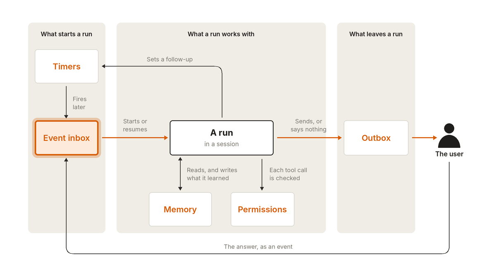

# Nectar — Building always-on agents

> **Thèse en une phrase** : un agent « always-on » n'est pas un agent qui tourne en continu, c'est un **système de state machine durable** qui réveille un agent bref sur événement, lui donne une mémoire persistante, l'encadre par des permissions, et contrôle la restitution via une outbox.

**Source** : William Hu, Anthropic, 2026-11-13 · [article](https://claude.com/fr/resources/articles/building-always-on-agents) · [contenu hors-ligne](content.md)

---

## 1. Always-on est une expérience, pas une architecture

L'agent passe l'essentiel de son temps **endormi**. Il se réveille périodiquement pour effectuer un **run** :

1. un événement arrive ;
2. une **session** démarre (ou reprend) ;
3. la boucle de l'agent s'exécute ;
4. le run écrit l'état persistant ;
5. l'agent se rendort.



Distinctions à garder :

| Terme | Définition |
|---|---|
| **Run** | Une exécution, d'un événement à sa fin. L'unité atomique de travail. |
| **Session** | Le transcript des messages et appels d'outils. Peut couvrir plusieurs runs. |
| **Mémoire** | L'état durable qui survit aux runs et aux workers. |
| **Worker** | Le service qui lit l'inbox et démarre les runs. |

**Pour notre framework** : un skill n'est pas un run. Un skill est une **procédure** invoquée dans un run. La durabilité, la reprise et la planification appartiennent au harnais, pas au skill.

---

## 2. Les cinq primitives

```text
           ┌──────────────┐
  events → │ Event inbox  │ → worker → run
           └──────────────┘              │
                  ▲                      ├──→ memory (durable)
           ┌──────┴───────┐              ├──→ permissions
           │   Timers     │              └──→ outbox → user
           └──────────────┘                      │
                  ▲                              │
                  └──────── user reply ──────────┘
```

### 2.1 Event inbox

**Problème** : si chaque source appelle l'agent directement, deux événements simultanés lancent deux runs concurrents, et un crash peut perdre un événement.

**Solution** : toutes les sources écrivent dans une **inbox durable** (une table), un handler HTTP acquitte vite, un worker lit les événements en attente.

Règles :

- une seule **source de vérité** : l'inbox ;
- **un seul worker actif** par inbox, pour éviter la duplication ;
- **déduplication** par identifiant de source ;
- **batching** des événements en attente (plusieurs messages utilisateur → un seul run) ;
- le handler **acquitte vite** ; la vérification profonde (prompt injection, etc.) se fait pendant le run ;
- si un événement arrive pendant un run : le pousser au run suivant, le fusionner, ou interrompre et redémarrer — choisir explicitement.



**Pour notre framework** : les déclencheurs d'un graphe de skills ne sont pas seulement « l'utilisateur parle ». Ce peut être un webhook, un changement d'issue, un commit, un timer. Le graphe a besoin d'une **porte d'entrée unique** et d'une politique de concurrence.

### 2.2 Timers

Deux types :

- **follow-up** : une échéance que l'agent se fixe (relancer dans 3 jours) ;
- **schedule** : une récurrence connue (newsletter quotidienne, audit hebdomadaire).

Les timers vivent dans un **store séparé** de l'inbox. L'inbox ne contient que ce qui est prêt à être traité. Un **scheduler** scanne les timers dus, met à jour leur état (follow-up terminé, schedule repoussé à la prochaine occurrence), puis ajoute un événement dans l'inbox.



**Pour notre framework** : un skill de veille, de revue périodique ou de relance a besoin d'un timer, pas d'une boucle infinie. La différence entre « schedule » et « follow-up » est une différence de **propriétaire de la décision** : l'utilisateur vs l'agent.

### 2.3 Memory

La mémoire est un **store séparé**, durable, qui survit au worker. Anthropic l'implémente comme un répertoire de fichiers ; pour un agent always-on, ce répertoire doit être adossé à une base ou un object store.

Règle d'or : **ne stocker que ce que l'agent ne peut pas retrouver ailleurs**. Si l'information vit déjà dans un issue tracker, stocker un **pointeur**, pas une copie.

Taxonomie :

| Type | Contenu | Chargement |
|---|---|---|
| **User instructions** | Règles de comportement données par l'utilisateur | Fichier dédié, chargé à chaque run |
| **User notes** | Rôle, préférences, corrections | Un fichier, puis plusieurs ; index chargé, détails à la demande |
| **Past messages** | Ce qui a déjà été dit à l'utilisateur, pour éviter les répétitions | Fichier dédié ou derniers messages chargés par le worker |
| **Task progress** | Ce qui est fait, ce qui reste, pour chaque tâche | Index chargé, fichiers de progression à la demande |



**Dreaming** : une passe qui relit les sessions passées pour curer la mémoire, remplacer les entrées obsolètes et trouver des motifs inter-runs.

**Pour notre framework** : la mémoire d'un projet est un actif du graphe. Il faut distinguer :

- les **instructions** (stables, toujours chargées) ;
- les **notes** (index + détail) ;
- l'**état d'avancement** (par tâche, avec reprise) ;
- les **pointeurs** vers les systèmes externes (tracker, CI, docs).

Un skill qui ne lit pas l'état d'avancement repart de zéro à chaque run. C'est le défaut le plus coûteux d'un système multi-sessions.

#### Le contexte est un coût fixe

Le system prompt, les définitions d'outils et les fichiers de mémoire sont chargés **à chaque run**. Il faut donc :

- garder l'overhead lean ;
- utiliser le prompt caching ;
- compacter les vieux messages ou démarrer une nouvelle session ;
- **persister ce qui doit survivre** avant la compaction, car la compaction perd du détail.



**Pour notre framework** : un skill toujours chargé coûte à chaque run. C'est le même arbitrage que `writing-for-agents` : `context load` vs `cognitive load`. La mémoire doit être indexée, pas monolithique.

### 2.4 Permissions

C'est la primitive la plus risquée : le run détient les accès de l'utilisateur et opère sans supervision.

Trois composants :

1. **Credential store** : un proxy hors de l'environnement de l'agent injecte les credentials dans les requêtes sortantes. L'agent ne les voit jamais.
2. **Auto mode** : des classificateurs examinent les actions à risque et bloquent les plus dangereuses ; l'humain reste nécessaire pour les décisions majeures.
3. **Deferred tool calls** : un hook peut différer un appel d'outil et attendre une entrée utilisateur. Le run se termine, la session est sauvegardée **au milieu de l'appel**, la demande est présentée à l'utilisateur (carte interactive, MCP App), et la réponse revient comme **événement dans l'inbox**. Un nouveau run reprend la session avec l'entrée.

Le point clé : **l'attente humaine ne bloque pas le worker**. Pendant que la réponse attend, le worker peut traiter d'autres événements.

**Pour notre framework** : les gates humaines doivent être des **nœuds du graphe**, avec un état « en attente d'approbation », pas des threads bloqués. Un skill qui dit « demande à l'utilisateur » sans mécanisme de reprise est incomplet.

### 2.5 Outbox

Un run peut se terminer de trois façons :

- il envoie un message dans l'**outbox** ;
- il décide qu'il n'y a rien à envoyer ;
- il utilise un **deferred tool call** pour demander une permission ou une entrée.

L'outbox est une table de messages sortants, avec un **dispatcher** analogue au worker. On n'en a besoin que si l'on veut **rythmer** les messages ou **récupérer** des erreurs. Sinon, un simple outil « send » suffit.



**Règle de produit** : commencer **silencieux**, puis gagner l'attention de l'utilisateur. Trop de messages = bruit ; pas assez = occasions manquées. Construire des evals pour trouver l'équilibre.

**Pour notre framework** : la sortie d'un skill n'est pas toujours un message. C'est souvent un **artefact** (PR, rapport, commit, ticket). L'outbox est le point où l'on décide **ce qui mérite d'être montré**.

---

## 3. Le cycle complet



1. Un événement entre dans l'inbox (message, webhook, timer).
2. Le worker démarre un run, dans une session nouvelle ou existante.
3. L'agent lit sa mémoire pour se mettre à niveau.
4. Il agit dans le cadre de ses permissions.
5. Il met à jour sa mémoire avec ce qu'il a appris.
6. Il pousse un message dans l'outbox.
7. Le dispatcher délivre.
8. La réponse de l'utilisateur revient comme événement.
9. Un timer peut réveiller l'agent plus tard.

Chaque run est bref, mais le cycle continue indéfiniment. C'est cette **continuité** qui donne l'impression d'un agent toujours allumé.

---

## 4. Implications pour notre framework de skills

### 4.1 Séparer le skill du runtime

Un skill est une **procédure de jugement**. Il ne doit pas embarquer :

- la boucle de réveil ;
- la persistance ;
- la déduplication ;
- la planification ;
- le rythme des messages.

Ces responsabilités appartiennent au **harnais**. Si on les met dans les skills, chaque skill réinvente une mauvaise version de la state machine.

### 4.2 Modèle de state machine pour le graphe

Le graphe de skills devrait distinguer :

- **états** : idle, ready, running, waiting_for_approval, blocked, done, failed ;
- **transitions** : event, timer, human response, gate pass/fail, retry budget exhausted ;
- **stores** : inbox (événements prêts), timers (échéances), mémoire (instructions, notes, progression), outbox (messages).

C'est une architecture **event-driven**, pas un appel de fonction récursif.

### 4.3 Chaque skill doit être idempotent et reprenable

Un run peut crasher, être interrompu, ou attendre une approbation. Un skill doit donc :

- lire l'état d'avancement avant d'agir ;
- écrire un état d'avancement après chaque unité vérifiable ;
- ne pas dupliquer une action déjà faite ;
- pouvoir reprendre au milieu d'un cycle.

C'est le pendant opérationnel du principe `make-operations-idempotent` de pstack.

### 4.4 Les gates humaines sont des événements

Une demande d'approbation n'est pas un `await` bloquant. C'est :

1. un run qui s'arrête et sauvegarde son contexte ;
2. une demande dans l'outbox ;
3. une réponse qui revient dans l'inbox ;
4. un nouveau run qui reprend.

**Pour notre framework** : chaque skill qui touche à une action irréversible doit déclarer **quelle approbation** il attend et **comment** le run reprend.

### 4.5 La mémoire est un contrat

Le graphe doit définir un **schéma de mémoire** stable :

```text
memory/
├── instructions.md      # toujours chargé
├── index.md             # index des notes et progressions
├── reported.md          # ce qui a déjà été dit
├── notes/               # notes par sujet, chargées à la demande
└── progress/            # un fichier par tâche, avec état et prochaine étape
```

Ce schéma est un **contrat entre skills** : chaque skill sait où lire et où écrire. Sans lui, chaque skill invente son propre format.

### 4.6 Le silence est une qualité

Un orchestrateur qui parle trop épuise l'utilisateur. L'outbox doit avoir une politique :

- message immédiat pour un blocage ou une décision ;
- digest pour les progrès ;
- silence pour les étapes intermédiaires ;
- escalade seulement quand la gate est franchie ou le budget épuisé.

### 4.7 Ce que cela change pour la phase de construction

Avant d'écrire des skills, il faut décider :

1. **Quel runtime** héberge le graphe (harness, serveur, CI, base de données) ?
2. **Quel store** porte l'inbox, les timers, la mémoire et l'outbox ?
3. **Quel schéma d'état** circule entre les nœuds ?
4. **Quelles gates** sont humaines, automatiques, ou mixtes ?
5. **Quelle politique de messages** est appliquée ?

Sans ces décisions, les skills seront des procédures isolées qui ne pourront pas fonctionner en continu.

---

## 5. Citations à garder

> « An always-on agent is not actually 'always on.' This is just a description of the user experience. »

> « Each stretch of work is called a run: the agent receives an event, completes its task, and then saves information about what happened. »

> « As a rule of thumb, memory should only hold what the agent can't look up again. »

> « While the deferred call waits for a response, the worker can pick up other events, so the agent isn't blocked. »

> « In practice, it's better for the agent to start quiet and then earn more of the user's attention over time. »
