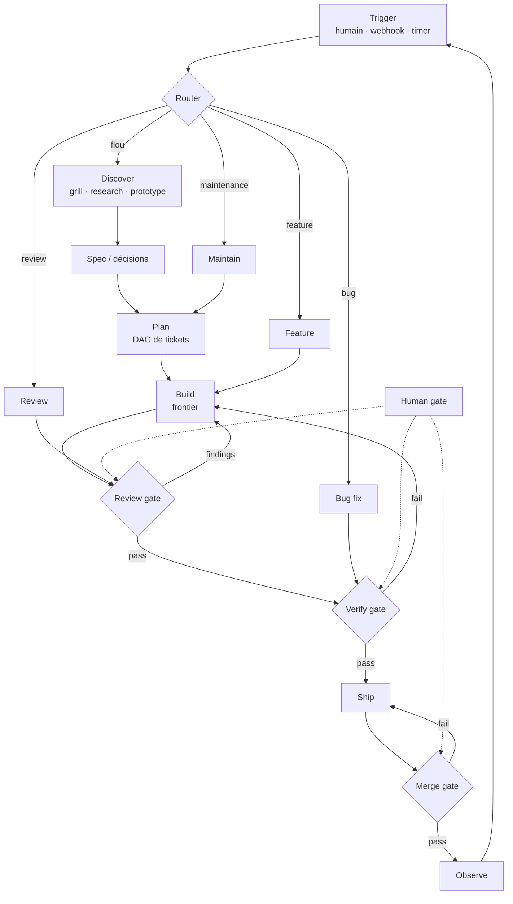

# Patterns d'orchestration

**But de ce document** : cataloguer les topologies et mécanismes de contrôle observés dans le corpus, puis en déduire les règles de conception de notre graphe.

Sources principales : `ask-matt` (flux idée → ship), `poteto-mode` + playbooks (pstack), `full-send` / `council` (tstack), l'échelle multi-agents de Ray Amjad, et les primitives always-on d'Anthropic.

---

## 1. Pourquoi orchestrer ?

Un skill isolé est une procédure. Un **système** de skills doit répondre à quatre questions :

1. **Qui déclenche ?** Un humain, un événement, un timer, un autre skill ?
2. **Dans quel ordre ?** Séquence, parallèle, graphe de dépendances, boucle ?
3. **Comment savoir que c'est fini ?** Preuve, gate, budget, approval ?
4. **Que se passe-t-il en cas d'échec ?** Retry, fallback, escalade, abandon ?

L'orchestration est la réponse à ces quatre questions. Sans elle, on a une collection de prompts, pas un framework.

---

## 2. Catalogue des patterns

### 2.1 Router / front door

**Forme** : un point d'entrée unique reçoit l'intention et sélectionne le bon skill ou playbook.

**Exemples** :

- `ask-matt` : routeur humain, user-invoked, qui décrit le flux et les on-ramps ;
- `poteto-mode` : mode user-invoked qui copie les étapes d'un playbook dans la todo ;
- `poteto-help` : aide à choisir un skill/playbook/principe ;
- `council` : un trigger verbal (« council ») sélectionne un panel de reviewers.

**Quand l'utiliser** : dès qu'il y a plus de 5–7 skills, ou que l'humain ne peut plus mémoriser lequel utiliser.

**Quand l'éviter** : si le routeur devient un monolithe de règles. Dans ce cas, extraire des playbooks.

**Risque** : le routeur qui fait le travail lui-même. Un routeur doit **router**, pas exécuter.

---

### 2.2 Pipeline / phase flow

**Forme** : une séquence de phases avec des artefacts de sortie.

**Exemple** (Matt Pocock) :

```text
grill-with-docs → (prototype) → to-spec → to-tickets → implement → code-review → pr → retro
```

Chaque phase a :

- un **input** (conversation, spec, tickets) ;
- un **output** (spec, tickets, code, review) ;
- une **frontière de contexte** (continue, clear, compact, handoff, subagent).

**Quand l'utiliser** : travail de bout en bout, avec des artefacts intermédiaires stables.

**Quand l'éviter** : travail exploratoire où les phases ne sont pas connues à l'avance.

**Risque** : pipeline trop rigide. Les phases doivent pouvoir être sautées ou réordonnées si l'évidence le justifie.

---

### 2.3 Task graph / frontier

**Forme** : un DAG de tickets, chacun déclarant ses **blocking edges**. L'exécution lance tous les nœuds de la **frontière** (dont les bloqueurs sont terminés).

**Exemple** (Matt Pocock) :

```text
01 schema ──→ 02 API ──→ 04 UI ──→ 06 e2e
                 ↑          ↑
03 seed ─────────┘          │
05 auth ────────────────────┘
```

`implement-spec` :

1. lit le graphe ;
2. lance un subagent d'exploration ;
3. crée une branche d'intégration ;
4. lance un implementer par ticket prêt, dans son worktree ;
5. merge via un merger subagent ;
6. recalcule la frontière ;
7. code review finale.

**Quand l'utiliser** : travail large, découpable en tranches verticales **prouvées indépendantes**.

**Quand l'éviter** : travail couplé, ou spec dont les frontières ne sont pas vérifiables.

**Risque** : surestimer l'indépendance. Un ticket qui touche un schéma partagé n'est pas indépendant d'un ticket qui touche l'API.

---

### 2.4 Fan-out / map

**Forme** : un parent distribue des sous-tâches indépendantes à N workers, puis agrège.

**Exemples** :

- `swarm` (pstack) : un worker par package, un rapport agrégé ;
- recherche de 5 bibliothèques d'authentification, 5 sous-agents ;
- chasse aux bugs dans différentes parties du codebase.

**Quand l'utiliser** : travail **réellement indépendant**, avec un critère d'agrégation clair.

**Quand l'éviter** : travail couplé, ou quand le coût de coordination dépasse le gain.

**Risque** : le fan-out comme défaut. Anthropic observe une **surutilisation** des subagents.

---

### 2.5 Swarm / coverage

**Forme** : N workers explorant des tranches ou des races, avec un objectif de couverture.

**Exemples** :

- `swarm` de pstack : couverture de packages ;
- chasse aux vulnérabilités : 266 findings pour 27 M tokens ;
- équipes OpenAI sur des preuves mathématiques : approches différentes, partage des découvertes.

**Quand l'utiliser** : recherche exhaustive, couverture, bug bashing, problèmes **indépendants**.

**Quand l'éviter** : construction d'application, travail enchevêtré, coordination de long terme.

**Risque** : la bureaucratie. Les agents passent plus de temps à négocier des règles qu'à travailler (Minecraft, personas).

---

### 2.6 Arena / bake-off

**Forme** : N tentatives sur **le même** brief, puis sélection d'une base et greffe des meilleures parties.

**Exemple** : `arena` (pstack) pour un design ou du code.

**Quand l'utiliser** : décision de design coûteuse à inverser, exploration d'un espace.

**Quand l'éviter** : travail de couverture (utiliser `swarm`), ou tâche triviale.

**Risque** : confondre `arena` (même brief, N variantes) et `swarm` (tranches différentes).

---

### 2.7 Pair / council

**Forme** : deux ou plusieurs agents échangent, souvent un générateur et un juge.

**Exemples** :

- builder / reviewer (Ray Amjad) : jusqu'à 3 rounds ;
- builder / verifier : jusqu'à 2 rounds ;
- `council` (tstack) : 3 modèles de 3 fournisseurs, score sur 10, rounds jusqu'à accord ;
- `sol-loop` : boucle builder/reviewer jusqu'à accord ;
- `interrogate` (pstack) : review multi-modèles adversarial, ne garde que les findings prouvés.

**Quand l'utiliser** : review, design contesté, vérification à la frontière de capacité.

**Quand l'éviter** : travail trivial, ou quand le modèle réussit déjà toujours.

**Risque** : scope creep par reviews répétées, et dépendance à un panel non représentatif. `council` insiste : « fight to keep scope limited ».

---

### 2.8 Builder / reviewer / verifier (boucle bornée)

**Forme** : le socle fiable.

```text
spec → builder → reviewer (≤3) → verifier (≤2) → merge
          ↑          │              │
          └── findings ┘              │
          └──────── failures ────────┘
```

**Règles** :

- le **même builder** corrige les findings (contexte architectural préservé, 38 % moins cher) ;
- le **reviewer** peut être un autre modèle (Codex review, Claude build) ;
- le **verifier** utilise des outils réels (Playwright, CDP, tests) ;
- les rounds sont **bornés** ; à épuisement, escalade humaine ;
- le verifier peut fan-out par flux utilisateur **indépendant**.

**Quand l'utiliser** : toute construction non triviale.

**Quand l'éviter** : micro-édition, ou modèle qui réussit déjà la tâche sans reviewer.

**Risque** : vérifier tout, tout le temps. Le gain est à la **frontière de capacité**.

---

### 2.9 Manager thread / coordinator

**Forme** : un thread central reçoit les instructions et délègue à des sessions isolées.

**Exemples** :

- chief of staff (Codex) ;
- session Claude Code locale connectée à Slack MCP, qui parle à des sessions distantes sandboxées (Ray Amjad) ;
- `chief-of-staff` (Matt, in-progress).

**Quand l'utiliser** : plusieurs workstreams en parallèle, besoin d'un point d'entrée unique.

**Quand l'éviter** : travail unique et séquentiel.

**Risque** : le coordinateur devient un goulot d'étranglement ou perd l'état. Il faut un **work log** partagé.

---

### 2.10 Long-lived leads (futur)

**Forme** : des leads par métier (programming, design, QA) qui vivent des semaines/mois, avec des workers, et se parlent comme des **pairs**.

**État** : pas fiable avec les modèles actuels. Les rôles/personas produisent de la bureaucratie et stagnent.

**Quand l'utiliser** : à expérimenter quand les modèles seront meilleurs en coordination pair-à-pair.

**Prérequis** : un **shared work log** avec objectif, état, ownership, et un protocole de communication.

---

### 2.11 Event-driven always-on

**Forme** : un cycle durable.

```text
event inbox → worker → run → memory/permissions → outbox → user
      ↑                                                      │
      └──────────────── user reply / timer ──────────────────┘
```

**Primitives** : inbox, timers, memory, permissions, outbox.

**Quand l'utiliser** : veille, agents proactifs, tâches longues, multi-sessions.

**Quand l'éviter** : session unique interactive.

**Risque** : complexité opérationnelle. Ne pas construire l'inbox avant d'avoir un besoin réel de durabilité.

---

### 2.12 Handoff / session pickup

**Forme** : un artefact portable (Markdown) permet à un nouvel agent de reprendre le travail.

**Exemples** : `handoff` (Matt), `session-pickup` (pstack), `takeover` (tstack).

**Quand l'utiliser** : changement de harnais, de répertoire, de collègue, ou reprise après pause.

**Risque** : handoff trop verbeux ou trop pauvre. Le bon handoff contient : objectif, état, décisions, artéfacts, prochaine étape, gates.

---

### 2.13 Human gate / questionnaire / wizard

**Forme** : une étape qui exige une entrée humaine non délégable.

**Exemples** : `wizard` (provisioning, credentials), `to-questionnaire` (information chez quelqu'un d'autre), deferred tool call (Anthropic).

**Quand l'utiliser** : action irréversible, information privée, décision produit.

**Risque** : bloquer le run. Une gate doit être un **événement**, pas un `await` qui gèle le worker.

---

### 2.14 Meta loop

**Forme** : le système améliore ses propres skills.

**Exemples** :

- `retro` : erreurs mécaniques → checks ;
- `correct` : corrections répétées → structure (architecture, types, lint, CI, tests, docs) ;
- `reflect` : tâche longue → édition de skill ;
- `eval` : variantes → test aveugle → promotion.

**Quand l'utiliser** : après chaque tâche longue, chaque correction répétée, chaque nouveau skill.

**Risque** : encoder une mauvaise leçon. Toujours valider par un eval ou une preuve.

---

## 3. Choisir la topologie

### 3.1 Arbre de décision

```text
Le travail est-il indépendant et vérifiable par morceaux ?
├── OUI → Les morceaux sont-ils nombreux et homogènes ?
│         ├── OUI → fan-out / swarm (couverture)
│         └── NON → DAG / frontier (tickets)
└── NON → Le travail est-il exploratoire ?
          ├── OUI → arena (N variantes) ou prototype
          └── NON → Le travail est-il couplé ?
                    ├── OUI → agent unique + compaction, ou pairs
                    └── NON → pipeline séquentiel
```

### 3.2 Matrice de couplage

| Couplage | Topologie | Exemple |
|---|---|---|
| **Indépendant, homogène** | Swarm / fan-out | Chasse aux vulnérabilités, audit de packages |
| **Indépendant, hétérogène** | DAG / frontier | Migration par package, feature multi-couches |
| **Séquentiel, couplé** | Pipeline | Spec → build → review → ship |
| **Couplé, contested** | Pairs / council | Review de design, vérification de race condition |
| **Exploratoire** | Arena / prototype | Choix d'architecture, UI |
| **Long terme, multi-workstream** | Manager thread | Programme de plusieurs PR |
| **Proactif, événementiel** | Always-on | Veille, maintenance, relances |

### 3.3 La règle d'or

> La topologie doit être choisie en fonction du **couplage réel**, pas de la mode, du nombre d'agents disponible, ou de la envie de paralléliser.

Un agent unique avec un bon contexte bat souvent cinq agents qui se coordonnent mal.

---

## 4. Les arêtes du graphe

Un graphe de skills ne se limite pas à `A → B`. Il faut distinguer les types d'arêtes :

| Arête | Signification | Exemple |
|---|---|---|
| `triggers` | Un événement démarre un run | webhook → triage |
| `blocks` | Un nœud doit finir avant un autre | schema → API |
| `requires` | Un nœud a besoin d'un artefact | review → diff |
| `reviews` | Un nœud examine la sortie d'un autre | reviewer → build |
| `verifies` | Un nœud prouve une propriété | verifier → feature |
| `repairs` | Un nœud corrige les findings d'un autre | finding → builder |
| `informs` | Un nœud nourrit la réflexion d'un autre | research → spec |
| `escalates` | Un nœud transfère à un humain | gate → approval |
| `resumes` | Une réponse humaine relance un run | approval → run |
| `produces` | Un nœud crée un artefact | builder → PR |

**Règle** : une arête doit avoir une **condition de franchissement**. « Quand le reviewer n'a plus de findings bloquants », « quand les tests passent », « quand l'humain approuve ». Une arête sans condition est une intention, pas une transition.

---

## 5. Le modèle d'état

Un run doit avoir un état explicite, sinon l'orchestrateur ne peut pas reprendre, dédupliquer ou escalader.

```yaml
run:
  id: run_...
  task_id: task_...
  phase: discover | specify | design | build | verify | ship | operate
  status: queued | running | waiting_human | blocked | done | failed | cancelled
  attempt: 1
  budget:
    max_review_rounds: 3
    max_verify_rounds: 2
    max_tokens: ...
  inputs:
    - artifact_ref
  context_refs:
    - memory/progress/task.md
  outputs:
    - artifact_ref
  evidence:
    - proof_ref
  decisions:
    - decision_ref
  approvals:
    - gate_id
  next:
    - skill_id
```

**Règles** :

- un run est **idempotent** : le relancer ne duplique pas les effets ;
- un run **checkpoint** après chaque unité vérifiable ;
- un run **waiting_human** ne bloque pas le worker ;
- un run **failed** laisse un état reprenable ;
- un run **done** exige une preuve, pas un self-report.

---

## 6. Le contrôle de flux

### 6.1 Boucles bornées

Toute boucle doit avoir :

- un **budget** (rounds, tokens, temps) ;
- un **critère de sortie** (succès, épuisement, escalade) ;
- un **propriétaire de contexte** (le builder garde le contexte) ;
- un **état de reprise** (checkpoint).

Sans budget, une boucle de review peut tourner indéfiniment ou dériver.

### 6.2 Gates

Une gate est une condition binaire :

- `pass` → transition ;
- `fail` → retour au nœud de réparation, ou escalade ;
- `wait` → gate humaine.

Les gates doivent être **observables**. « Le code est bon » n'est pas une gate. « Les checks requis sont verts, chaque finding est corrigé ou rejeté avec une raison, la branche est mergeable » est une gate.

### 6.3 Fallbacks

Un skill doit déclarer quoi faire si :

- un modèle est indisponible ;
- un outil manque ;
- un fichier pointé n'existe pas ;
- une permission est refusée.

Le fallback ne doit pas être silencieux : il doit être rapporté.

### 6.4 Escalade

L'escalade est une transition vers un humain. Elle doit être :

- **rare** (sinon le système ne sert à rien) ;
- **actionnable** (une question précise, avec options et recommandation) ;
- **non bloquante** pour le reste du système.

### 6.5 Agrégation

Quand plusieurs workers produisent, il faut un **fan-in** :

- un rapport unique, pas N rapports bruts ;
- une synthèse des désaccords ;
- une décision de merge ;
- une trace des contributions.

---

## 7. Contexte et concurrence

### 7.1 Context pointers

Le parent ne doit pas inliner le contexte des enfants. Il pointe vers :

- le spec ;
- les tickets ;
- les notes de recherche ;
- les commits ;
- les artefacts de preuve.

**Règle** : communiquer par pointeurs, pas par duplication.

### 7.2 Subagents frais

Un subagent frais avec un **scope consolidé** est souvent meilleur qu'un subagent réutilisé :

- brief original ;
- directives ultérieures ;
- rapport et branche du précédent.

On réutilise un agent seulement si le nouveau travail a besoin d'un état coûteux à déplacer (checkout, changements non commités, process en cours).

### 7.3 Isolation

- un **worktree** par agent qui écrit ;
- une **branche** par PR ;
- une **branche d'intégration** pour le graphe de tickets ;
- jamais deux agents qui écrivent dans le même checkout ;
- un **merger** pour résoudre les conflits.

### 7.4 Un seul écrivain par artefact

Si deux nœuds peuvent écrire le même fichier, la concurrence est un bug de design. Il faut :

- séparer les artefacts ;
- ou sérialiser les écritures ;
- ou introduire un coordinateur.

C'est le principe `separate-before-serializing-shared-state` de pstack.

---

## 8. Le routage par modèle

Le modèle est une ressource, pas une constante.

| Rôle | Modèle | Exemple |
|---|---|---|
| **Code** | Fort, rapide | Opus 5.5 / Sol Medium |
| **Hardest tasks** | Le plus fort | Fable 5.2 / Astra |
| **Prose / judgment** | Fort | Opus 5.5 |
| **Swarm workers** | Rapide, cheap | Modèle high-fast |
| **Review panel** | Diversité de familles | Claude + GPT + Gemini |
| **Verification** | Rapide, outillé | Modèle high-fast avec browser |

**Règles** :

- la politique de modèles est **externe** aux skills (config) ;
- chaque rôle a un défaut et un fallback ;
- ne pas changer la famille d'un panel diversifié ;
- un modèle rejeté ne doit pas être retenté à l'aveugle ;
- le routage doit être **observable** dans le rapport.

---

## 9. Le graphe cible (proposition)

Ce diagramme est une **famille de nœuds**, pas encore des skills concrets :



**Propriétés** :

- un seul point d'entrée ;
- des boucles bornées autour du build ;
- des gates explicites ;
- une gate humaine possible à chaque étape ;
- une observation qui peut re-déclencher le cycle.

---

## 10. Les échecs d'orchestration

| Échec | Cause | Correctif |
|---|---|---|
| **Sur-décomposition** | Supposer l'indépendance sans preuve | Décomposer seulement aux frontières vérifiables |
| **Concurrence dans un worktree** | Deux agents écrivent au même endroit | Un worktree par agent |
| **Boucle infinie** | Pas de budget ni de gate | Budget + critère de sortie + escalade |
| **Bureaucratie** | Trop de rôles/personas | Skills fonctionnels, pas de personnages |
| **Vérification partout** | Peur du bug | Vérifier à la frontière de capacité |
| **Routeur monolithe** | Toutes les règles dans un fichier | Playbooks + principes séparés |
| **Couplage caché** | Tickets « indépendants » qui touchent le même schéma | Déclarer les artefacts partagés |
| **Harnais fossilisé** | Hypothèses de modèle obsolètes | Déclarer et réévaluer les hypothèses |
| **Orchestrateur qui exécute** | Le routeur fait le travail | Router uniquement, déléguer |
| **Outbox bruyante** | Chaque étape notifie | Politique de messages, digest, silence |

---

## 11. Règles de conception pour notre graphe

1. **Un point d'entrée unique.** L'humain parle à un routeur, pas à 50 skills.
2. **Un nœud = une responsabilité vérifiable.** Pas de skill fourre-tout.
3. **Une arête = une condition.** Pas de transition implicite.
4. **Un budget par boucle.** Review ≤3, verify ≤2, retry ≤N.
5. **Un propriétaire de contexte par cycle.** Le builder corrige ses findings.
6. **Une preuve par nœud.** Chaque nœud produit un artefact observable.
7. **Une gate humaine par action irréversible.** Pas de gate pour le réversible.
8. **Une topologie par couplage.** Pipeline, DAG, fan-out, swarm, pairs.
9. **Un état externe.** Le graphe ne vit pas dans le contexte du modèle.
10. **Une hypothèse de suppression.** Chaque nœud doit pouvoir disparaître.

---

## 12. Questions ouvertes

- **Comment déclarer le couplage ?** Un champ `parallel_safe_with`, `shared_artifacts`, `requires` ?
- **Comment choisir la topologie automatiquement ?** Un classificateur, une heuristique, ou une décision humaine ?
- **Comment représenter les gates dans le format de skill ?** Un champ `gates`, ou un skill séparé ?
- **Comment mesurer le coût d'orchestration ?** Tokens, temps, nombre de messages, charge humaine ?
- **Quand un routeur doit-il être model-invoked plutôt que user-invoked ?** Dépend de la fréquence et du risque.
- **Comment éviter que le graphe devienne un monolithe ?** Une limite de taille par nœud, des playbooks, des références.
