# The skill graph

Every skill, what it does in a few words, and which skills it runs. For how a task flows from request to merge, read [How the framework works](README.md). The first part is the graph between skills; [the second](#inside-ship) opens `ship`: its steps, its loops, its playbooks, and its budgets.

Each edge here comes from the skill's own frontmatter: `calls:` is a solid arrow, `reads:` a dashed one. A skill with no edge works alone. You can launch any skill yourself; an arrow means the skill also runs the other one inside its own work.

## Legend

| Arrow | Meaning |
|---|---|
| `A --> B` | A runs B as one of its steps |
| `A -.-> B` | A reads B's files, its rules or its reply format, without running it |
| `A ==> B` | A writes or updates B, a skill generated in your repo |

## The graph, in six small pieces

One diagram with every edge is unreadable, so the graph is cut by question. Each piece shows every edge of its topic; together they hold every edge, and [the table below](#every-skill-with-its-edges) lists them per skill.

### 1. Delivering one task

`ship` owns the task from start to ready PR. Inside, it runs the review chain.

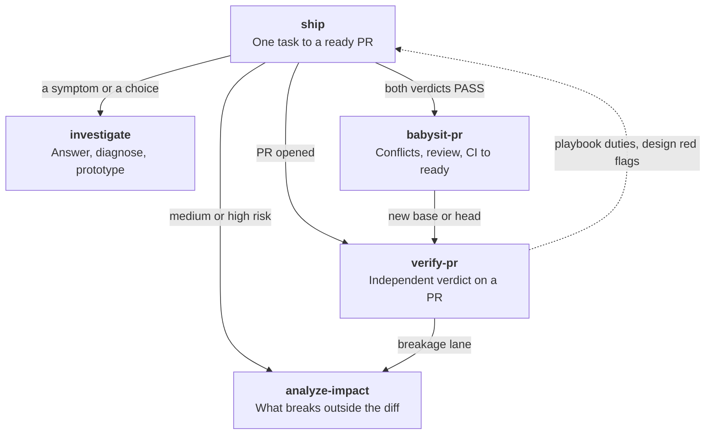

### 2. Starting and resuming work

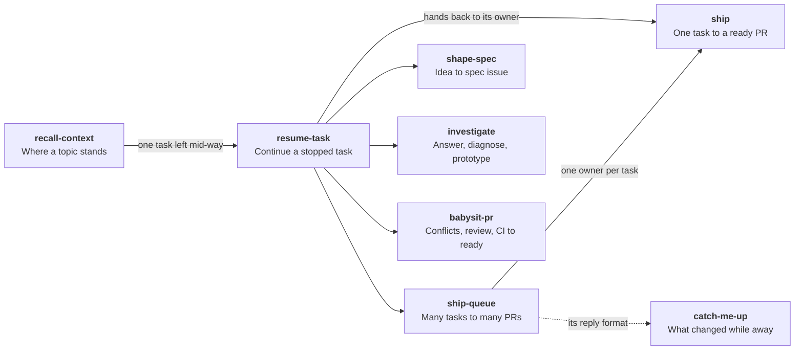

### 3. Preparing a repo and a spec

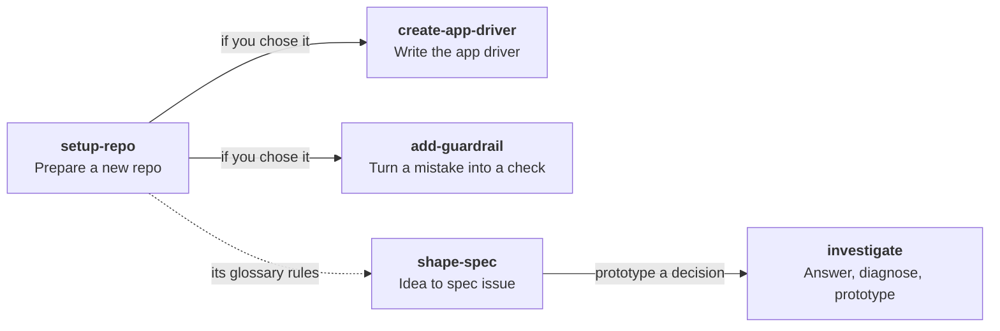

### 4. Building the project's tools

A task builds the proof it lacks before it changes the code.

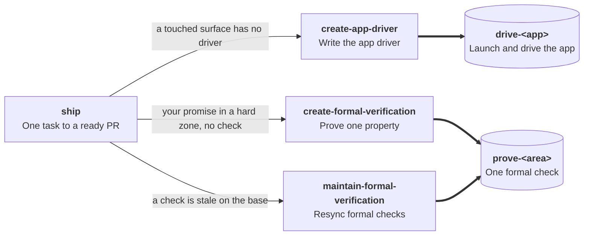

### 5. Using the project's tools

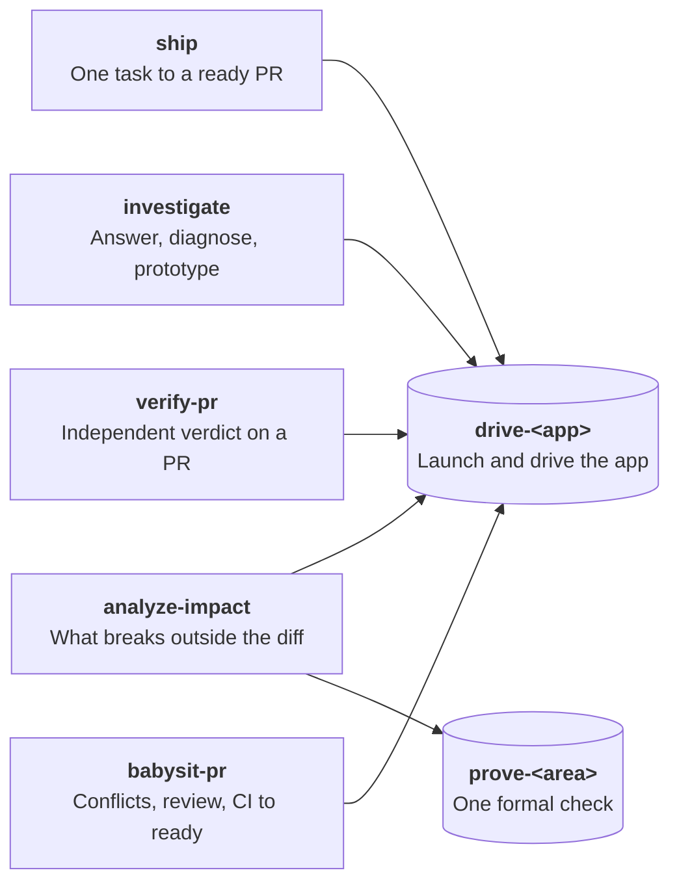

### 6. Learning from a mistake

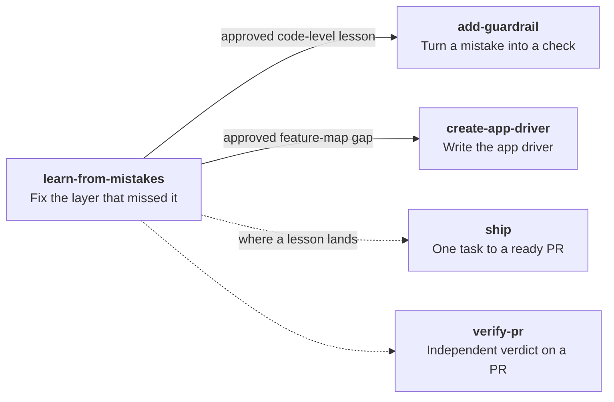

## Inside ship

The six pieces above show which skill runs which. This part opens `ship` itself: its eight steps, the loop each step runs, the playbooks, and where each loop stops. Each piece links the file that holds its rules.

### 7. The eight steps

The main path, top to bottom. A dashed arrow is a stop; [the budget table](#every-loop-and-its-budget) lists every one.

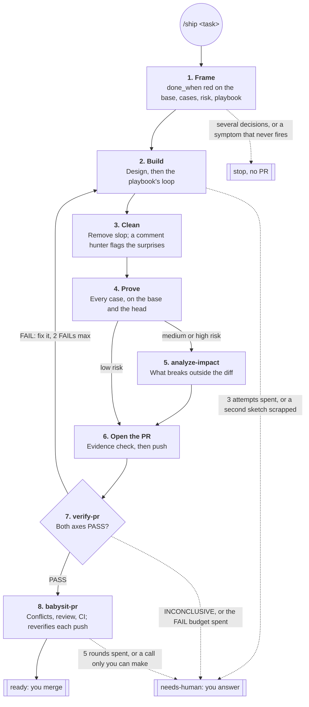

Your answer to a `needs-human` PR, in the session or as a PR comment, removes the label and restarts the loop that stopped, with a fresh budget (rule 11 of [the constitution](constitution/README.md)).

### 8. Step 1, framing

Before the frame, `ship` checks what already exists, reproduces a bug, and settles what is unclear. [frame.md](ship/references/frame.md)

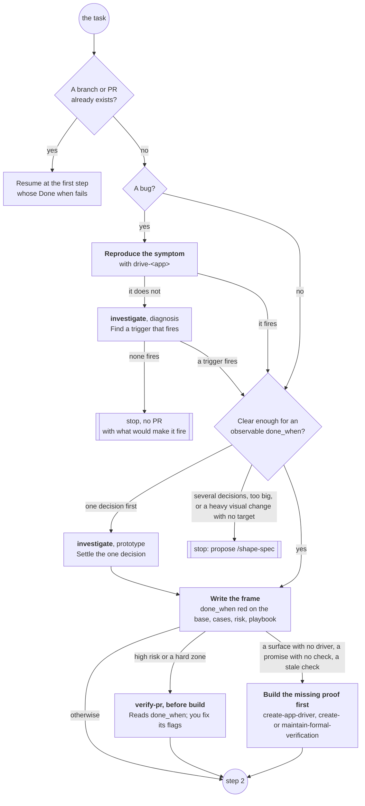

### 9. Step 2, design and build

A change inside one function body names its data shape and builds. A change that crosses a function boundary runs the whole design loop. [design.md](ship/references/design.md)

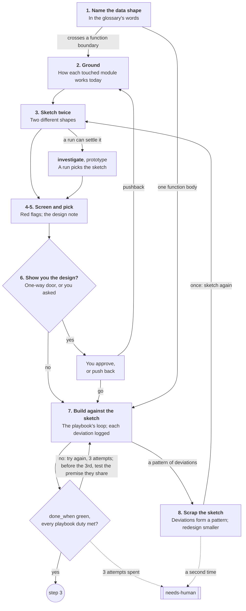

### 10. The playbooks

Step 1 picks one playbook per task, step 2 follows it, and `verify-pr` checks its duties. A task that fits two rows is two units, one PR each, the second stacked on the first. [frame.md](ship/references/frame.md#playbooks)

| Playbook | Pick it when | `done_when` | The loop inside | The verifier checks |
|---|---|---|---|---|
| [bug-fix](ship/references/playbooks/bug-fix.md) | a behavior is wrong | the symptom you reported | a command that goes red on this bug; rule out causes by runtime evidence; fix the root; look for siblings | the repro commit comes before the fix, red on the base and green on the head; missed siblings |
| [feature](ship/references/playbooks/feature.md) | a behavior is missing, or a screen to build | the new journey works | one vertical slice at a time: one test, the least code, the next test; then the [target loop](ship/references/visual-loop.md) for visual targets | each new test fails with the code reverted; every entry point; the bolt-on it rejected |
| [refactoring](ship/references/playbooks/refactoring.md) | the structure changes, the behavior does not | the target structure, red on the base; a pin, green on both | small steps, the pin green after each one | the pin on base and head; no added behavior; where reading got easier |
| [perf](ship/references/playbooks/perf.md) | a path is too slow | a number on a named path | measure, try the cheapest fix, measure again, one attempt at a time | the measurement replayed; each number's checks |
| [hillclimb](ship/references/playbooks/hillclimb.md) | one metric must reach a target over many attempts | a target and a floor on attempts | keep or revert each attempt, on a frozen harness, logged | the harness replayed; each kept commit moved the metric past the noise |
| [visual-parity](ship/references/playbooks/visual-parity.md) | the UI must look the same after a migration | the migration target, red on the base; an image diff of zero | diff each component, fix each changed pixel, diff again until zero | the harness rerun; the baseline and harness untouched |
| [bespoke](ship/references/playbooks/bespoke.md) | none of the above: a wide migration, a change in several parts | a yes-or-no check on the real product | stacked units, each its own PR through steps 2 to 7; one `babysit-pr` over the stack | each PR green alone; no caller of the old form left |

`hillclimb`, the target loop of `feature`, and each unit of `bespoke` run the same experiment loop. `perf` runs it too, one measured attempt at a time.

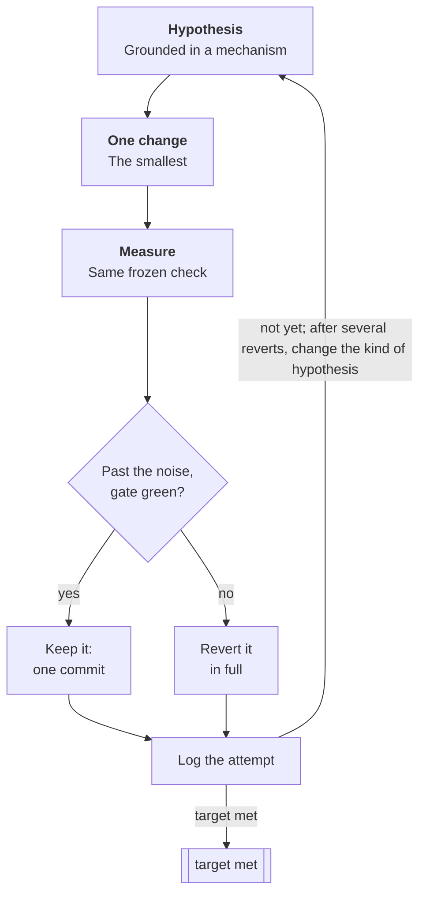

### 11. Steps 7 and 8, verdict and babysitting

The verifier is a fresh agent that tries to break the PR. A FAIL goes back to the builder, and every push goes back to the verifier. [verify-pr](verify-pr/SKILL.md), [babysit-pr](babysit-pr/SKILL.md)

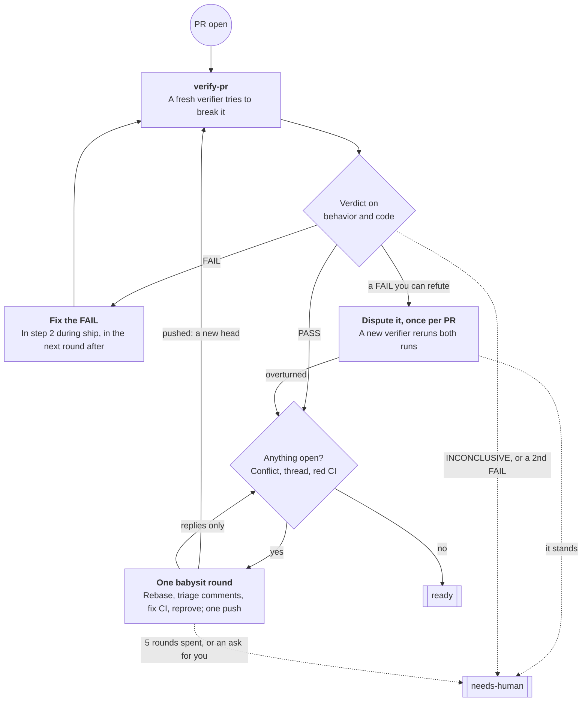

### Every loop and its budget

Rule 7 of [the constitution](constitution/README.md) holds for each: inside the budget, a plateau means change the approach; before the last attempt, write the premise the attempts share and test it; never relax `done_when`.

| Loop | Where | Budget | When it runs out |
|---|---|---|---|
| Build attempts | `ship` step 2 | 3 | the PR still opens, `needs-human` |
| Scrapped sketch | `ship` step 2, [design.md](ship/references/design.md) step 8 | 1 | a second scrap: the PR opens `needs-human` |
| Comment hunter report | `ship` step 3, [clean.md](ship/references/clean.md) | 1 retry | `needs-human` |
| Target loop | `feature` duty 8, [visual-loop.md](ship/references/visual-loop.md) | 10 passes for stills, 10 for motion | a measured check fails: `needs-human`; only the scores fall short: the PR goes on with its gaps |
| FAIL verdicts | `ship` step 7 and `babysit-pr` | 2 per PR, counted across both; 1 dispute | `needs-human` |
| Babysit rounds | `babysit-pr` | 5 | `needs-human`, with the premise the rounds shared |
| CI flake | `babysit-pr` step 4 | 1 rerun | reported as a flake |
| Waiting with no PR watcher | `babysit-pr` | a check every 5 to 10 minutes, for 2 hours | `needs-human`, with what the PR waits on |

Three stops are not loops: a frame that needs several decisions from you and a symptom no trigger makes fire, both before any PR, and an evidence check that finds discrepancies when the PR opens, which leaves a draft labeled `needs-human`.

## Skills that work alone

These run no other skill. Launch them when the situation fits.

| Skill | What it does |
|---|---|
| [choose-skill](choose-skill/SKILL.md) | Tells you which skill to launch and with what command; launches nothing |
| [sharpen-prompt](sharpen-prompt/SKILL.md) | Rewrites a prompt you are about to send so it asks for deeper work |
| [pause-task](pause-task/SKILL.md) | Stops the running task at a safe point and leaves a resume note |
| [clean-worktrees](clean-worktrees/SKILL.md) | Removes the worktrees of finished tasks, never losing unsaved work |
| [say-it-plainly](say-it-plainly/SKILL.md) | Says the last reply again, shorter, with no jargon |
| [show-me](show-me/SKILL.md) | Shows the current topic as the smallest clear diagram or diff |
| [test-skill-change](test-skill-change/SKILL.md) | Tests blind whether a skill change makes the agent work better |

`catch-me-up` is in the graph only because `ship-queue` reuses its reply format; you launch it alone too.

## Every skill, with its edges

| Skill | What it does | Runs | Run by |
|---|---|---|---|
| [add-guardrail](add-guardrail/SKILL.md) | Turns a repeated mistake into a check, proven red on the real mistake | | setup-repo, learn-from-mistakes |
| [analyze-impact](analyze-impact/SKILL.md) | Finds what a change breaks outside its diff and proves the fact it is safe because of | drive-\<app\>, prove-\<area\> | ship, verify-pr |
| [babysit-pr](babysit-pr/SKILL.md) | Drives an open PR to ready: conflicts, review, CI; stops before the merge | verify-pr, drive-\<app\> | ship, resume-task |
| [catch-me-up](catch-me-up/SKILL.md) | Tells you what changed while you were away, and each call waiting on you | | (format read by ship-queue) |
| [choose-skill](choose-skill/SKILL.md) | Tells you which skill to launch | | |
| [clean-worktrees](clean-worktrees/SKILL.md) | Removes finished worktrees safely | | |
| [create-app-driver](create-app-driver/SKILL.md) | Writes `drive-<app>`, the skill that launches and drives the app like a user, with its feature map | writes drive-\<app\> | ship, setup-repo, learn-from-mistakes |
| [create-formal-verification](create-formal-verification/SKILL.md) | Proves one property where a bug costs most, and writes `prove-<area>` | writes prove-\<area\> | ship |
| [investigate](investigate/SKILL.md) | Answers a question, diagnoses a symptom, or settles a choice by prototype; opens no PR | drive-\<app\> | ship, shape-spec, resume-task |
| [learn-from-mistakes](learn-from-mistakes/SKILL.md) | Finds the layer that missed a mistake and proposes its fix; applies nothing unapproved | add-guardrail, create-app-driver | |
| [maintain-formal-verification](maintain-formal-verification/SKILL.md) | Brings formal checks back in line with the code; says drift or bug for each failure | updates prove-\<area\> | ship |
| [pause-task](pause-task/SKILL.md) | Stops a task safely with a resume note | | |
| [recall-context](recall-context/SKILL.md) | Rebuilds where a topic stands from past sessions and the repo | resume-task | |
| [resume-task](resume-task/SKILL.md) | Continues a task an earlier session left, without redoing what was done | ship, investigate, shape-spec, babysit-pr, ship-queue | recall-context |
| [say-it-plainly](say-it-plainly/SKILL.md) | Restates the last reply in plain words | | |
| [setup-repo](setup-repo/SKILL.md) | Prepares a repo the first time: tracker, labels, glossary, standards, driver | create-app-driver, add-guardrail | |
| [shape-spec](shape-spec/SKILL.md) | Turns a loose idea into a spec issue through an interview, or a map of decisions | investigate | resume-task |
| [sharpen-prompt](sharpen-prompt/SKILL.md) | Rewrites a prompt to ask for deeper work | | |
| [ship](ship/SKILL.md) | Turns one task into a ready-to-merge PR, proven and independently verified | investigate, analyze-impact, verify-pr, babysit-pr, create-app-driver, create-formal-verification, maintain-formal-verification, drive-\<app\> | ship-queue, resume-task |
| [ship-queue](ship-queue/SKILL.md) | Turns a list of tasks into as many PRs, one owner per task | ship | resume-task |
| [show-me](show-me/SKILL.md) | Shows the topic as the smallest clear visual | | |
| [test-skill-change](test-skill-change/SKILL.md) | Compares the old and new version of a skill blind | | |
| [verify-pr](verify-pr/SKILL.md) | Tries to break a PR and gives a verdict on behavior and on code | analyze-impact, drive-\<app\> | ship, babysit-pr |

`drive-<app>` and `prove-<area>` are not shipped by this framework: they are written for each repo, by the skills that point to them.
