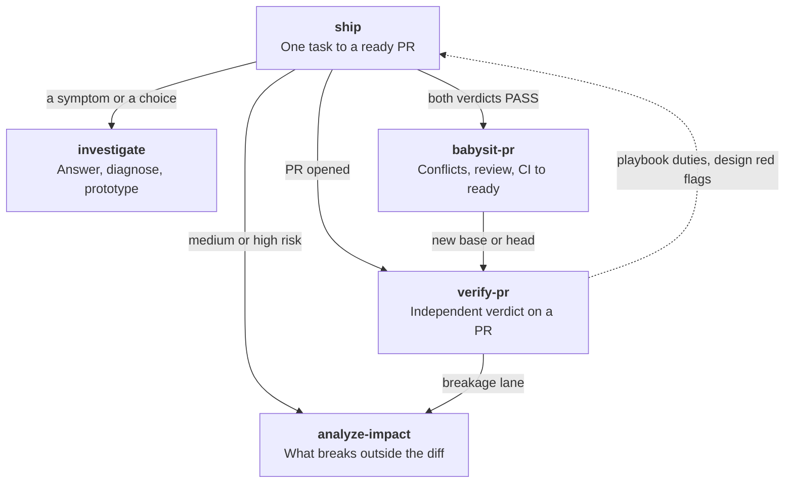
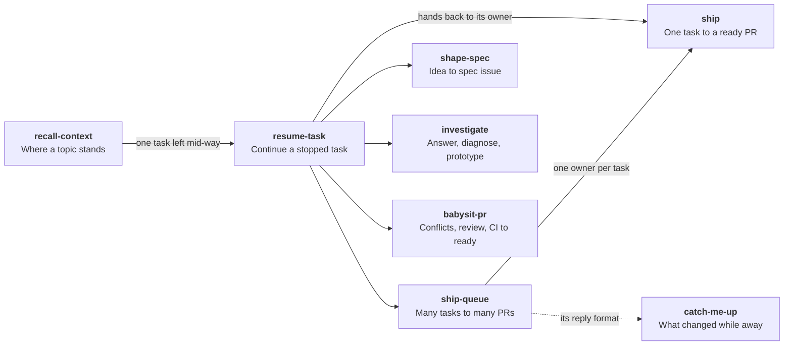
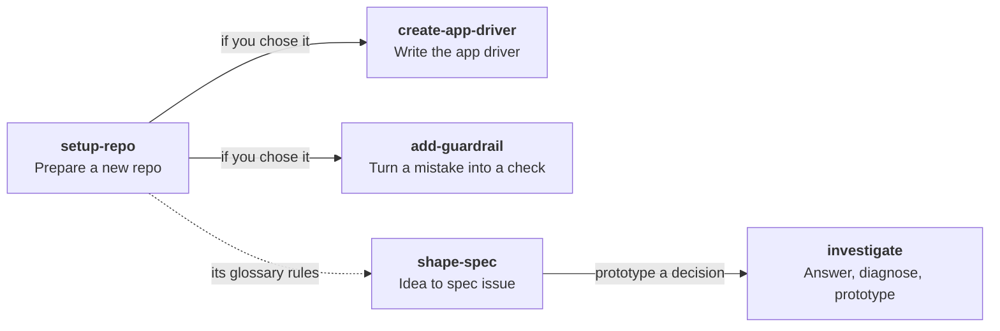
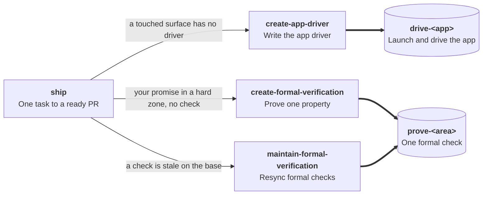
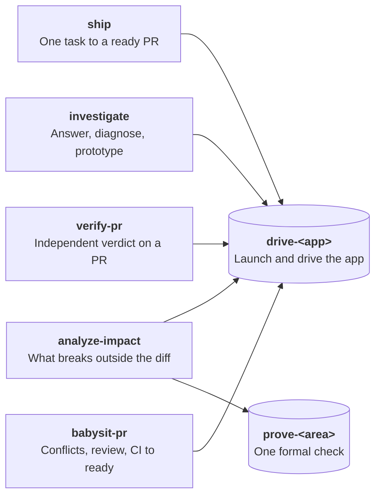
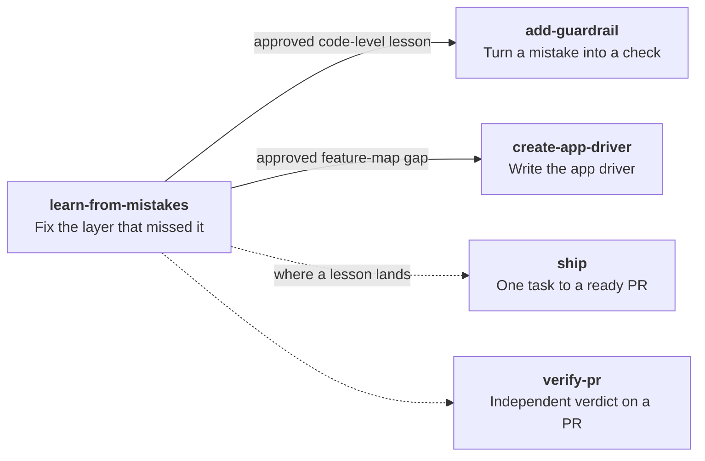

# The skill graph

Every skill, what it does in a few words, and which skills it runs. For how a task flows from request to merge, read [How the framework works](README.md); this page is only the graph.

Each edge here comes from the skill's own frontmatter: `calls:` is a solid arrow, `reads:` a dashed one. A skill with no edge works alone. You can launch any skill yourself; an arrow means the skill also runs the other one inside its own work.

## Legend

| Arrow | Meaning |
|---|---|
| `A --> B` | A runs B as one of its steps |
| `A -.-> B` | A reads B's files, its rules or its reply format, without running it |
| `A ==> B` | A writes or updates B, a skill generated in your repo |

## The graph, in six small pieces

One diagram with every edge is unreadable, so the graph is cut by question. Each piece shows every edge of its topic; together they hold every edge, and [the table below](#every-skill-with-its-edges) lists them per skill.

### 1. Delivering one task

`ship` owns the task from start to ready PR. Inside, it runs the review chain.

### 2. Starting and resuming work

### 3. Preparing a repo and a spec

### 4. Building the project's tools

A task builds the proof it lacks before it changes the code.

### 5. Using the project's tools

### 6. Learning from a mistake

## Skills that work alone

These run no other skill. Launch them when the situation fits.

| Skill | What it does |
|---|---|
| [choose-skill](choose-skill/SKILL.md) | Tells you which skill to launch and with what command; launches nothing |
| [sharpen-prompt](sharpen-prompt/SKILL.md) | Rewrites a prompt you are about to send so it asks for deeper work |
| [pause-task](pause-task/SKILL.md) | Stops the running task at a safe point and leaves a resume note |
| [clean-worktrees](clean-worktrees/SKILL.md) | Removes the worktrees of finished tasks, never losing unsaved work |
| [say-it-plainly](say-it-plainly/SKILL.md) | Says the last reply again, shorter, with no jargon |
| [show-me](show-me/SKILL.md) | Shows the current topic as the smallest clear diagram or diff |
| [test-skill-change](test-skill-change/SKILL.md) | Tests blind whether a skill change makes the agent work better |

`catch-me-up` is in the graph only because `ship-queue` reuses its reply format; you launch it alone too.

## Every skill, with its edges

| Skill | What it does | Runs | Run by |
|---|---|---|---|
| [add-guardrail](add-guardrail/SKILL.md) | Turns a repeated mistake into a check, proven red on the real mistake | | setup-repo, learn-from-mistakes |
| [analyze-impact](analyze-impact/SKILL.md) | Finds what a change breaks outside its diff and proves the fact it is safe because of | drive-\<app\>, prove-\<area\> | ship, verify-pr |
| [babysit-pr](babysit-pr/SKILL.md) | Drives an open PR to ready: conflicts, review, CI; stops before the merge | verify-pr, drive-\<app\> | ship, resume-task |
| [catch-me-up](catch-me-up/SKILL.md) | Tells you what changed while you were away, and each call waiting on you | | (format read by ship-queue) |
| [choose-skill](choose-skill/SKILL.md) | Tells you which skill to launch | | |
| [clean-worktrees](clean-worktrees/SKILL.md) | Removes finished worktrees safely | | |
| [create-app-driver](create-app-driver/SKILL.md) | Writes `drive-<app>`, the skill that launches and drives the app like a user, with its feature map | writes drive-\<app\> | ship, setup-repo, learn-from-mistakes |
| [create-formal-verification](create-formal-verification/SKILL.md) | Proves one property where a bug costs most, and writes `prove-<area>` | writes prove-\<area\> | ship |
| [investigate](investigate/SKILL.md) | Answers a question, diagnoses a symptom, or settles a choice by prototype; opens no PR | drive-\<app\> | ship, shape-spec, resume-task |
| [learn-from-mistakes](learn-from-mistakes/SKILL.md) | Finds the layer that missed a mistake and proposes its fix; applies nothing unapproved | add-guardrail, create-app-driver | |
| [maintain-formal-verification](maintain-formal-verification/SKILL.md) | Brings formal checks back in line with the code; says drift or bug for each failure | updates prove-\<area\> | ship |
| [pause-task](pause-task/SKILL.md) | Stops a task safely with a resume note | | |
| [recall-context](recall-context/SKILL.md) | Rebuilds where a topic stands from past sessions and the repo | resume-task | |
| [resume-task](resume-task/SKILL.md) | Continues a task an earlier session left, without redoing what was done | ship, investigate, shape-spec, babysit-pr, ship-queue | recall-context |
| [say-it-plainly](say-it-plainly/SKILL.md) | Restates the last reply in plain words | | |
| [setup-repo](setup-repo/SKILL.md) | Prepares a repo the first time: tracker, labels, glossary, standards, driver | create-app-driver, add-guardrail | |
| [shape-spec](shape-spec/SKILL.md) | Turns a loose idea into a spec issue through an interview, or a map of decisions | investigate | resume-task |
| [sharpen-prompt](sharpen-prompt/SKILL.md) | Rewrites a prompt to ask for deeper work | | |
| [ship](ship/SKILL.md) | Turns one task into a ready-to-merge PR, proven and independently verified | investigate, analyze-impact, verify-pr, babysit-pr, create-app-driver, create-formal-verification, maintain-formal-verification, drive-\<app\> | ship-queue, resume-task |
| [ship-queue](ship-queue/SKILL.md) | Turns a list of tasks into as many PRs, one owner per task | ship | resume-task |
| [show-me](show-me/SKILL.md) | Shows the topic as the smallest clear visual | | |
| [test-skill-change](test-skill-change/SKILL.md) | Compares the old and new version of a skill blind | | |
| [verify-pr](verify-pr/SKILL.md) | Tries to break a PR and gives a verdict on behavior and on code | analyze-impact, drive-\<app\> | ship, babysit-pr |

`drive-<app>` and `prove-<area>` are not shipped by this framework: they are written for each repo, by the skills that point to them.
