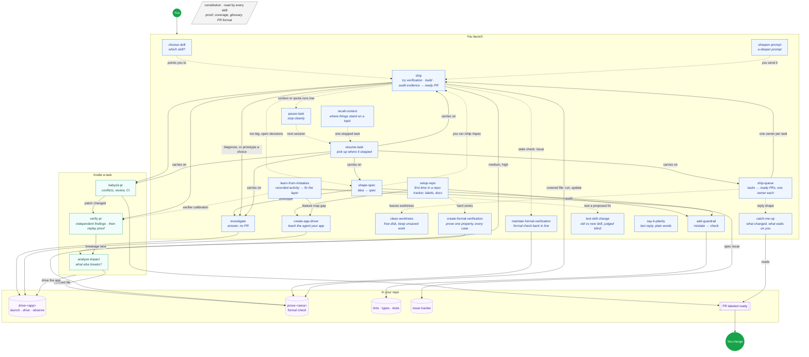
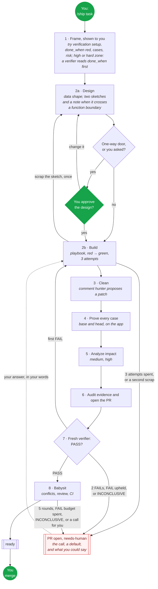

# Skills

You launch every skill yourself; the ones in the middle run inside a task. Not sure which to launch? `/choose-skill`. Every skill reads [the constitution](constitution/README.md) first.

## The map

## One task, from your words to your merge

Green is you: you launch, you approve a design only when it goes through a one-way door or you asked to see it, and you merge. The task also stops for what only you can decide: a product or preference call no run can settle, or evidence that rules out what you asked for (rule 11 of the constitution). Nothing starts without you.

Every PR a skill opens, not only `ship`'s, goes through `verify-pr` and `babysit-pr` before it is `ready` (rule 2).
