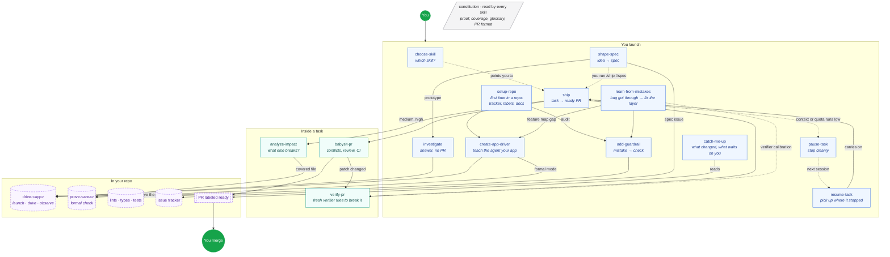
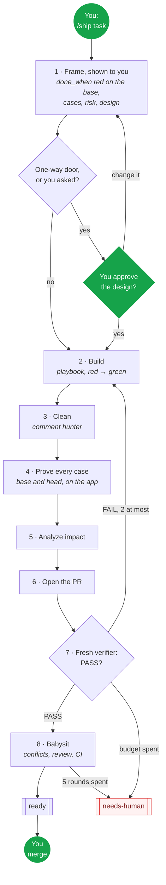

# Skills

You launch every skill yourself; the ones in the middle run inside a task. Not sure which to launch? `/choose-skill`. Every skill reads [the constitution](constitution/README.md) first.

## The map

## One task, from your words to your merge

Green is you: you launch, you approve a design only when it goes through a one-way door or you asked to see it, and you merge. Nothing else waits on you, and nothing starts without you.
