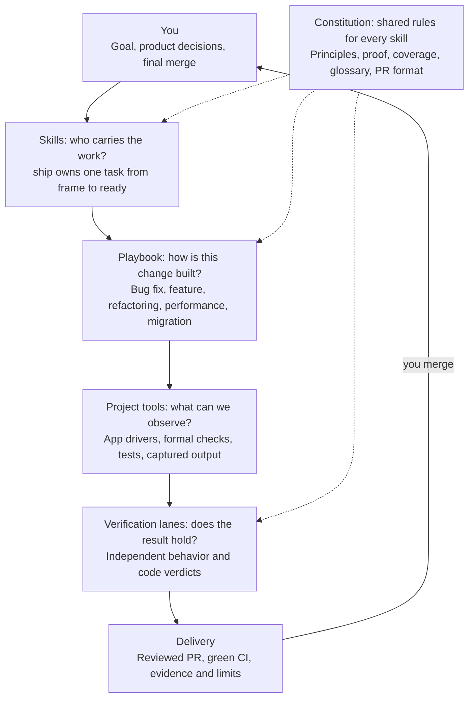
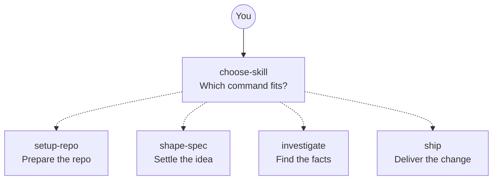
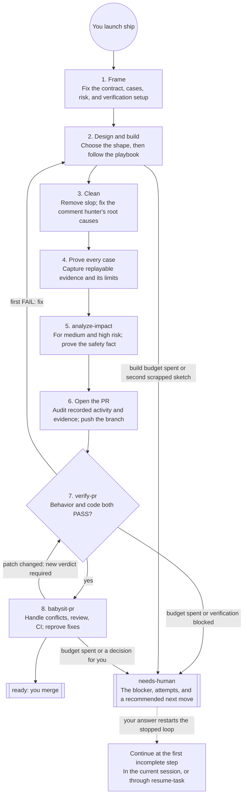
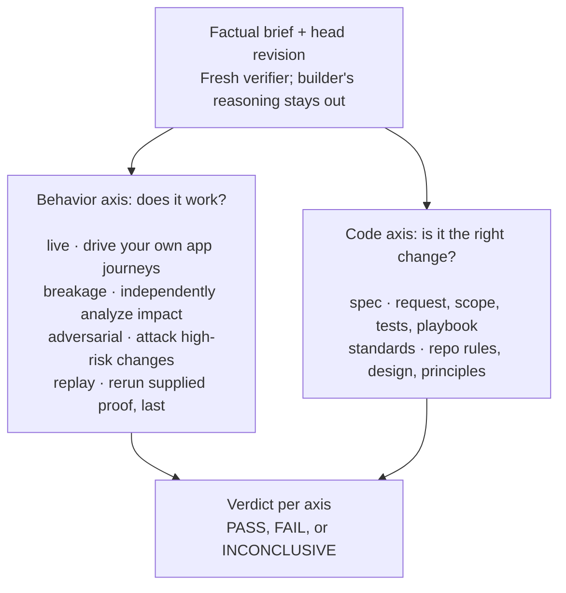
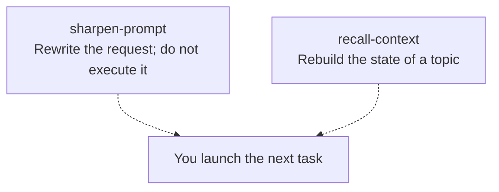
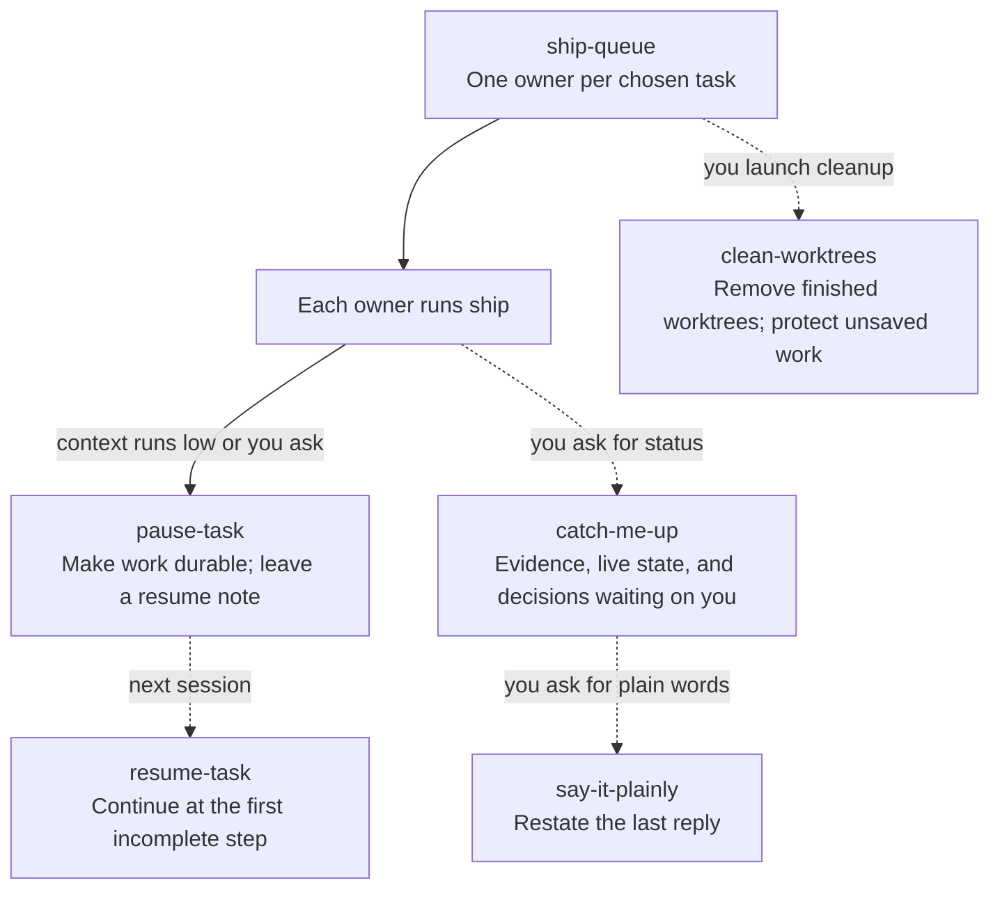
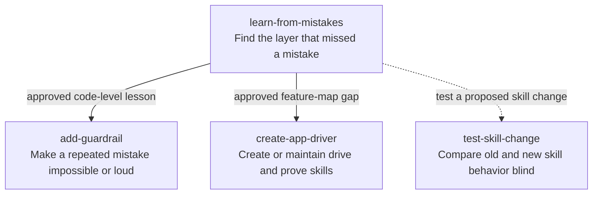

# How the framework works

This framework carries a software task from your request to a PR you can assess and merge. A builder makes the change and supplies evidence; a fresh verifier tries to break it; the builder handles review and CI. You start the work, make product decisions, and merge.

Start with [the layers](#1-the-layers), follow [one task](#3-one-task-from-request-to-merge), then read [the playbooks](#4-the-seven-playbooks) and [verification](#5-how-verification-works). The last sections cover [project files](#6-where-the-files-and-state-live), [supporting skills](#7-working-across-tasks-and-sessions), and [lessons](#8-how-the-framework-learns).

This is a reading map of the current skill files. Each section links to the instructions that define the behavior. For installation, see the [root README](../README.md); for prompts to copy, see [the user guide](../docs/guide.md). The framework is v0: written procedures and passing tool checks do not establish that every workflow works in a real repo.

## 1. The layers

A **skill** owns a workflow, a **playbook** supplies the build duties for a kind of change, and a verification **lane** answers one review question. They fit together like this:

| Layer | What it owns | Where to read |
|---|---|---|
| Shared rules | Who decides, what counts as proof, how findings block, when to stop | [constitution](constitution/README.md); every skill reads it first; it is not a launchable skill |
| Principles | Design and engineering judgment, selected when their application conditions fit | [principles index](constitution/references/principles.md), then the full form of each principle used |
| Skills | Steps, roles, inputs, outputs, and retry budgets for a workflow | Each skill's linked `SKILL.md` below |
| Playbooks | Additional build and proof duties for one kind of task | [playbook selection](ship/references/frame.md#playbooks) |
| Project tools | How to launch the app, drive its surfaces, find its entry points, and check properties | [Drivers and formal checks](#6-where-the-files-and-state-live) |
| Verification | Independent attempts to disprove the result, followed by a verdict | [verify-pr](verify-pr/SKILL.md) and its [lanes](verify-pr/references/lanes.md) |
| Harness | How the agent spawns, isolates work, asks questions, and watches PRs | [Capability mapping](constitution/references/harness.md); unavailable capabilities must be reported |

The **builder** keeps ownership of the PR through review fixes. The **verifier** starts with fresh context, reads and runs, and does not edit the code. It uses another model family when the harness offers one, otherwise a fresh agent of the same family. A **coordinator** manages several task owners without writing their code.

## 2. Choose where to enter

You launch skills explicitly. Inside a launched task, its instructions call other skills by reading their files; you do not need to launch every step yourself. Nothing starts on a timer or picks up new work on its own.

The dotted arrows are recommendations, not automatic calls: you launch the suggested skill. You can also launch any skill directly. Once setup, a spec, or an investigation has prepared the task, you launch `ship` to implement it. During implementation, `ship` can itself call `investigate` to diagnose a symptom or prototype a choice. The detailed build and retry path is in the next section.

| What you arrive with | Start here | What you receive |
|---|---|---|
| An unfamiliar repo | [setup-repo](setup-repo/SKILL.md) | A readiness report and the private or shared setup parts you chose |
| An idea with unresolved decisions | [shape-spec](shape-spec/SKILL.md) | A spec issue, or a map of decisions for work too large to settle in one session |
| A question, unexplained symptom, or technical choice | [investigate](investigate/SKILL.md) | An answer with evidence and limits; a proposed task if a change is due |
| A task or a spec ready to implement | [ship](ship/SKILL.md) | A PR labeled `ready`, or `needs-human` with the reason and recommendation |
| An existing PR needing an independent verdict | [verify-pr](verify-pr/SKILL.md) | A verdict comment for behavior and code, with findings and notes |
| An existing PR needing conflicts, review, or CI handled | [babysit-pr](babysit-pr/SKILL.md) | The PR brought to `ready` or an explained stop |
| Uncertainty about the right command | [choose-skill](choose-skill/SKILL.md) | A recommendation; it launches nothing |

A large spec stays with one builder through an ordered series of PRs using `bespoke`. Several tasks you already chose can use `ship-queue`; the distinction is explained [below](#7-working-across-tasks-and-sessions).

## 3. One task, from request to merge

The normal path is `/ship <task or issue>`. Its contract is **`done_when`**: an observable condition drawn from your request. **Base** means the starting revision; **head** means the proposed revision. The condition must fail on the base and pass on the head. A refactoring also has a **behavior pin**, a test or script recording existing behavior, that stays green on both.

| Step | What happens and why | Result you can inspect |
|---|---|---|
| **1. Frame** | Restate the request, list the cases and interfaces under test, choose the risk class and playbook. Try startup, access, and evidence capture before implementation. For high risk or a hard zone, a verifier checks the proposed contract before code exists. | The frame shown to you, the red base run, and any setup limits. [Frame](ship/references/frame.md), [verification setup](ship/references/verification.md) |
| **2. Design and build** | Name the data shape before logic. Features and changes to types, signatures, or module boundaries need grounding, two structurally different sketches, and a design note. Build against the chosen shape using the playbook. | The chosen and rejected designs, recorded deviations, and `done_when` green. [Design](ship/references/design.md) |
| **3. Clean** | Remove dead code, debug output, and workarounds. A fresh comment hunter proposes deletions and flags symbols whose design should explain itself; the builder validates the patch and fixes the root causes. | A cleaned diff, resolved flags or linked issues, and green lint, types, and tests. [Clean](ship/references/clean.md) |
| **4. Prove every case** | Run the case list through the relevant user paths. Keep scripts and captures, update changed feature maps, and identify what could not be verified. Visual journeys need a scripted demo; stateful journeys need a state chart. | A coverage table with evidence per case, plus explicit gaps. [Coverage](constitution/references/coverage.md) |
| **5. Analyze impact** | For medium and high risk, follow callers, data formats, timing, dependencies, and error paths beyond the diff. Find and run the test of the fact the change is safe because of. High risk widens the search to several agents. | The safety fact, its run or `unproven` status, and confirmed risks fixed or tracked. [analyze-impact](analyze-impact/SKILL.md) |
| **6. Open the PR** | Compare the claimed work with recorded activity and artifacts. Check the local evidence index, push the task branch, and open the PR in the shared format. | The linked issue when applicable, design, coverage, proof, impact, decisions, and limits. [PR format](constitution/references/pr-format.md), [evidence audit](ship/references/verification.md) |
| **7. Get a verdict** | A fresh verifier receives factual inputs, independently looks for failures, then replays the builder's proof. The builder fixes proven findings or uses the one permitted dispute. | Separate behavior and code verdicts on the current patch, with findings and notes. [verify-pr](verify-pr/SKILL.md) |
| **8. Babysit and hand over** | Resolve conflicts, answer review, and fix CI. Reprove each fix and obtain a new verdict when the patch changes. Refresh the evidence before handback. | `ready` only when both axes pass, checks are green, review bots have finished, and nothing remains open. You merge. [babysit-pr](babysit-pr/SKILL.md) |

Launching is permission to continue through reversible work. Design approval is required for a one-way door, such as a public API, schema, or storage format, or when you asked to see it. Product or preference decisions that no run can settle, and evidence ruling out the request, also stop the task. These rules come from [the constitution](constitution/README.md).

The limits are **3 build attempts**, **one scrapped sketch**, **2 FAIL verdicts per PR across build and babysitting**, and **5 babysitting rounds**. A round groups fixes into one push. Budgets trigger a replan and an explained stop, never a weaker `done_when`. A stop before the normal PR-opening step still opens a PR with what was proved and what remains. Your answer restarts the stopped loop with a fresh budget; [resume-task](resume-task/SKILL.md) resumes at the first unmet completion criterion, including directly in `babysit-pr` when only PR readiness remains.

Every PR a skill opens follows the verdict and babysitting path, including setup, docs, and guardrail PRs. A `bespoke` stack gets a verdict per unit, then one babysitting pass over the stack. The agent stops before merging.

For example, suppose a user reports that double-clicking Save creates two notes. The layers turn that request into the following work; this is an illustration, not a completed run:

| Layer | In this bug fix |
|---|---|
| Contract and cases | Reproduce two notes on the base; require one note after two clicks; include keyboard save, retry, and an action already in flight where applicable |
| Playbook | `bug-fix`: commit the failing repro, establish the cause with runtime evidence, fix it, and rerun the same command |
| Project tools and proof | Use the app driver to perform the clicks; read back the stored notes; attach the base/head run and demo to the coverage table |
| Independent review | Select lanes from the risk class and hard zones; try another path, inspect the state representation, and replay the supplied evidence |
| Delivery | Reprove review fixes, obtain passing verdicts on the final patch, wait for green CI, then hand you the PR to merge |

## 4. The seven playbooks

`ship` chooses **one playbook per task** during framing. The playbook changes the build and proof duties inside the same lifecycle; it does not replace independent review. Each file also says what the verifier must check.

| Playbook | Choose it when | What makes its method different | Required evidence |
|---|---|---|---|
| [bug-fix](ship/references/playbooks/bug-fix.md) | Existing behavior is wrong | Reproduce the reported symptom before framing; eliminate candidate causes; commit the repro before the fix; search for siblings. | The same repro red on base and green on head; the real app journey when user-visible |
| [feature](ship/references/playbooks/feature.md) | Behavior is missing | Build one vertical slice at a time; integrate with the existing design; cover every entry point and every consumer of an improved primitive. | New tests fail when the implementation is reverted; the new journey works on the app |
| [refactoring](ship/references/playbooks/refactoring.md) | Structure changes while behavior stays the same | Capture a behavior pin before moving code; subtract first; migrate callers and remove the old internal API. | A structural target red then green, a behavior pin green on both, and reduced reader load |
| [perf](ship/references/playbooks/perf.md) | A specific path is too slow or costly | Validate the baseline, profile the limiter, try the cheapest effective fix, and compare under identical conditions. | Base/head numbers with units, repeated runs, median and range, plus correctness checks |
| [hillclimb](ship/references/playbooks/hillclimb.md) | One metric needs sustained improvement toward a target | Freeze a validated measurement harness; log every hypothesis; measure one attempt at a time; keep or revert it. | The target and minimum attempt count, a regression gate, and one commit per kept improvement |
| [visual-parity](ship/references/playbooks/visual-parity.md) | A UI migration must preserve appearance exactly | Capture every relevant component state first; freeze the harness and baselines; migrate primitives before consumers. | Zero image diff against the baseline; one PR per component or safe batch |
| [bespoke](ship/references/playbooks/bespoke.md) | A migration or multi-part task needs its own sequence | Write the phases first; one builder carries ordered, independently verifiable units; wide changes use expand, migrate, contract. | A green check and verdict per PR, a decision log, and end-to-end proof on the final PR |

If two playbooks apply, split the work into separate units with separate PRs, stacked in order. Questions, diagnoses, and throwaway prototypes belong to [investigate](investigate/SKILL.md), which opens no PR. Selection rules live in [frame.md](ship/references/frame.md#playbooks).

## 5. How verification works

There are three separate checks on the result: the **builder's evidence**, the **independent verifier's attempts**, and the **repo's CI and review state**. Green tests alone do not cover all three.

### Evidence: show the result through the right surface

The builder maintains a case list before coding and a coverage table in the PR. Cases include the request, entry points and callers, relevant edge cases, and formal properties covering touched files. Each row has replayable evidence or an explicit reason under **Not verified**. See [coverage](constitution/references/coverage.md).

| Certainty level | What was actually established |
|---|---|
| 1 — said | The agent made a claim |
| 2 — pointed | A real file and line were identified |
| 3 — reasoned | The case was traced step by step |
| 4 — ran | A script or test exercised the real code and could expose the failure |
| 5 — reproduced | The result was observed in the running app through a user path |

`done_when` needs level 5 for an app with a user-facing surface, and level 4 for a library or stateless CLI. The safety fact needs level 4 or is marked `unproven`. A formal check proves its stated property within its model or bounds; a demo shows the driven journeys. Neither establishes behavior outside that scope. The requirements are defined in [proof.md](constitution/references/proof.md).

### Independent review: two axes, six lanes

The verifier starts from the task, `done_when`, case list, risk class, diff, and safe setup instructions. It saves independent findings before reading the builder's proof and decisions or old discussions. `spec` and `standards` run in fresh parallel agents where supported; otherwise the verifier runs them sequentially and reports that limit.

The diagram shows the available lanes; the risk class selects which run. Each lane returns findings with evidence, or what it tried when it found nothing. Full procedures: [lanes.md](verify-pr/references/lanes.md).

| Lane | The question it answers | What the verifier does |
|---|---|---|
| `replay` | Does the PR's claimed proof hold? | Rerun its commands and demos; compare the actual results and coverage with the claims |
| `live` | Does the app satisfy the contract? | Build its own journeys, drive base and head, try entry points and edge cases, then check claimed coverage |
| `breakage` | What breaks outside this diff? | Run `analyze-impact` independently, then compare safety facts and risks |
| `adversarial` | Can deliberate attempts break it? | Run three agents on a factual brief, rerun their reproductions, merge duplicate root causes |
| `spec` | Is this all of the request, with no extra behavior? | Compare the diff with the task, revert the fix to test the tests, and check the playbook's duties |
| `standards` | Does the code follow the repo's rules and a sound design? | Read applicable standards, glossary, ADRs, and language rules; check smells, design red flags, and relevant principles |

### Risk: spend verification where failures matter

| Class | Selection rule | Lanes and additional checks |
|---|---|---|
| `low` | All changed files are docs/tests, or roughly 30 lines within one function with no hard zone or public interface change | `replay`, `spec`, `standards`; short frame |
| `medium` | Everything between low and high | Low lanes plus `live`; `breakage` when a hard zone is touched; builder runs impact analysis |
| `high` | Auth, payments, migrations, data deletion, CI, secrets, or more than 400 changed lines | All six lanes; verifier reads `done_when` before build; impact analysis widens |

A hard zone also triggers the pre-build contract review for a medium task. The verifier can raise a class it judges too low. The canonical [risk rules and hard-zone list](constitution/references/proof.md#risk-classes) cover concurrency, sync, retries, data loss, security, and other areas needing deeper verification. When a required live surface has no driver, the lane is **INCONCLUSIVE**, not PASS; the remedy is to prepare the driver or access.

### Principles: how review finds design improvements

The `standards` lane reads the full form of principles cited in the PR's Decisions or Design, **and those whose “Apply when” matches the diff even if the builder did not cite them**. Each principle supplies how to apply it, a test, a “Sign it was skipped,” and an example. Review uses those signs to find missed opportunities; see the [principles index](constitution/references/principles.md).

For example, a diff adding a second boolean that must stay synchronized with the first is a reason to examine whether the state should be represented explicitly. The verifier checks the relevant domain-modeling principle and the actual diff, then explains the finding. A smell or design judgment is a note unless a documented repo standard makes it a rule. This review is scoped to the PR; it is not a scheduled search for improvements across the whole codebase.

### Verdict: what blocks, and what happens next

A FAIL must be proven, be in scope, and meet the blocker or should grade. Behavioral findings need a reproduction the verifier reran; a documented-standard breach can instead quote the file, rule, and hunk. Other findings remain notes. A missing case that works correctly is a coverage gap: the builder adds it with the verifier's evidence before `ready`.

| Outcome | Meaning | Next step |
|---|---|---|
| Both axes PASS | Every selected lane ran without a FAIL; notes may remain | Babysit review and CI, then hand over as `ready` |
| An axis FAIL | At least one proven, blocking finding | Builder fixes and obtains a new verdict, within the shared FAIL budget; one dispute is allowed |
| An axis INCONCLUSIVE | A required lane could not run because of an external limit | `needs-human`, with what would make it runnable; retry only after the setup changes |

A verdict covers a **patch id**, the stable hash of the diff. A pure rebase can retain it; a changed patch needs a new verdict. Notes become issues only when you ask. The authoritative grades, outcomes, and comment format live in [verdict.md](verify-pr/references/verdict.md).

## 6. Where the files and state live

The framework ships shared workflows. Project-specific knowledge lives separately, private by default, so using it on a team repo does not impose those files on the team.

| Home | What lives there | How it is used |
|---|---|---|
| This framework's `skills/` | Skills, playbooks, shared rules, and language rules | Installed as folders; every workflow reads the shared references by path |
| `~/.agents/projects/<project>/` | Tracker instructions, glossary, ADRs, coding standards, rule table, drivers, formal checks | Shared by the repo's worktrees; private entries are written in place |
| Target repo | Product code, tests, CI, the team's own docs, and any project entries explicitly shared | Changes go through a PR; existing team files take precedence |
| Code host and issue tracker | PRs, issues, labels, verdict comments, review threads, task and decision records | Durable task state; reread before acting rather than trusting a session summary |
| Work directory and linked artifacts | The local evidence index, run outputs, screenshots, demos, and other captures | Indexed and checked before PR opening and handback; the PR links the evidence |

[create-app-driver](create-app-driver/SKILL.md) creates **`drive-<app>`**, one driver per surface: how to launch, check health, drive the app, capture evidence, and clean up. Its **feature map** records entry points, drive steps, and expected end states so builder and verifier know which paths to cover.

Its [formal mode](create-app-driver/references/formal.md) creates **`prove-<area>`** for a property whose failures tests rarely reach, using a model checker or code verifier as appropriate. `analyze-impact` runs it when covered files are touched; stale models are reported and need a maintenance pass.

These generated skills are project-specific, not additional skills shipped by this framework. When you share one, it lives under `.agents/skills/` in the repo and the project folder contains a one-hop route to it. `<project>` is derived from the repo's remote. File ownership, routing, and label definitions are in [target-repo.md](constitution/references/target-repo.md).

## 7. Working across tasks and sessions

These skills support the lifecycle; they are not extra mandatory stages of every PR. The following maps separate preparation, continuity, and improvement so each stays readable. Solid arrows show work within a launched workflow; dotted arrows show a user handoff, recommendation, or optional next command.

**Prepare the next task.** Improve the request or recover the history before deciding what to launch.

**Carry work across time.** A queue owns the tasks you chose. Each owner can pause safely; you can resume, request a report, or clean up afterward.

**Improve the layer that failed.** A lesson can change enforced checks, project tools, or the framework itself, after you approve it.

| Skill | When it helps | What it leaves behind |
|---|---|---|
| [ship-queue](ship-queue/SKILL.md) | You have several chosen tasks | One owner and PR per task, at most three owners running; tasks touching the same files are ordered and stacked |
| [pause-task](pause-task/SKILL.md) | You stop, or context or usage limits approach | Durable work and a resume note; a queue also records its owners' states |
| [resume-task](resume-task/SKILL.md) | A task or answered PR needs to continue | Live state rebuilt, cheap prerequisites checked, then the owning workflow resumed |
| [recall-context](recall-context/SKILL.md) | You need the history and current state of a topic | A short, sourced brief from sessions and repo records |
| [catch-me-up](catch-me-up/SKILL.md) | You want to understand work done while away | Changes with their evidence, live PR state, and each decision waiting on you with a recommendation |
| [clean-worktrees](clean-worktrees/SKILL.md) | Finished or abandoned tasks consume disk | Worktrees removed safely; unsaved work requires your decision and branches are retained |
| [sharpen-prompt](sharpen-prompt/SKILL.md) | You want a better request before launching work | A rewritten prompt asking for stronger methods and evidence; no task execution |
| [say-it-plainly](say-it-plainly/SKILL.md) | The previous reply is hard to act on | The same facts and pending decisions, shorter and without jargon |

A `ship-queue` coordinates tasks you supplied; it does not split one spec into assignments for agents. A large spec uses `bespoke`, preserving one builder's context. Queue handoff checks the actual PR evidence and current verdict, not just an owner's report.

## 8. How the framework learns

Improvement is user-launched too. [learn-from-mistakes](learn-from-mistakes/SKILL.md) examines a session, failed PR, or escaped bug and asks **which layer should have caught it**. It proposes accepted changes, rejected findings, and backlog items; you approve changes before they are applied.

| What failed | Where the improvement belongs |
|---|---|
| Code allowed a recurring mistake | [add-guardrail](add-guardrail/SKILL.md): architecture, a type, lint, or a test; prove it red on the real mistake and green on the fix |
| The contract missed the user's goal | Framing or specification |
| A user path had no case | Feature map and coverage rules, maintained through [create-app-driver](create-app-driver/SKILL.md) |
| The app was driven incorrectly | The project's driver |
| Wider breakage was missed | `analyze-impact` |
| Review missed or waved away a defect | Verifier calibration and a replay that now catches the defect |
| A skill gave the wrong instructions | A change in this framework's repo, with [test-skill-change](test-skill-change/SKILL.md) offered to compare old and new behavior blind |

The full routing rules are in [learn-from-mistakes/routes.md](learn-from-mistakes/references/routes.md). Approved repo changes each go through their own PR, verdict, and babysitting. Mechanical lessons should become enforced structure or checks; judgment calls belong in standards.

To check this framework itself, run `python -I tools/check.py` from its root. It tests the tools, lints the skills, and checks references and skill inventory, including names in these diagrams. It does not prove that the prose, diagram edges, or real-world workflows are correct; those still need review and task runs.
