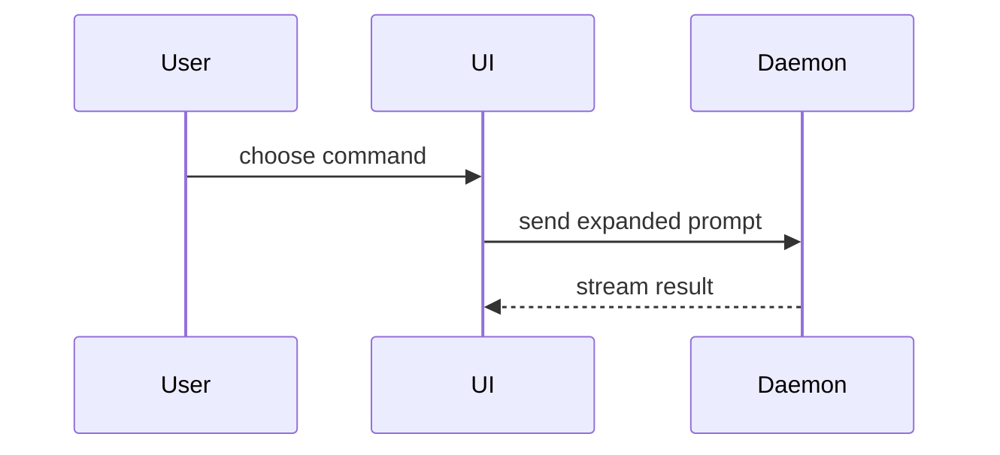

# The catalog of views

Each view, when to pick it, and an example. Pick the smallest one that makes the key point clear.

## Pseudocode: logic or an algorithm

```text
on(save)
  if content is unchanged
    return cached result
  write new content
  return fresh result
```

## Call tree: runtime control flow

```text
submitForm
  createSession
    persistPrompt
    launchAgent
  navigateToSession
```

## Component tree: UI structure, with the state and module boundaries that matter

```tsx
<SessionPage> (apps/example/src/routes/session.tsx)
  useSessionEvents()
  <SessionToolbar>
    <RunSkillButton> (packages/ui)
```

## File tree: file responsibility or a broad refactor, kept shallow

```text
src/
├── commands/       # parses user actions
├── sessions/       # owns session state
└── transport/      # sends API requests
```

## Mermaid: component interaction, control flow, or data flow



## Diff: the point is what changes and the surrounding shape already exists

Match the diff shape to the topic: a component change, a file-layout change, a call-tree change, or a state or control-flow change.

```diff
 <SessionPage>
   useSessionEvents()
   <SessionToolbar>
+    <RunSkillButton />
   <SessionTimeline>
+    <SkillResultCard />
```

```diff
 src/
 ├── commands/
+│   └── show-me.ts       # expands the slash command
 ├── sessions/
-└── transport.ts
+└── transport/
+    ├── client.ts
+    └── stream.ts
```

```diff
 on(save)
-  write content
+  if content is unchanged
+    return cached result
+  write new content
+  invalidate cache
```

## Whole block: most of it is new, or the user needs a copyable target shape

Show the whole block when most of it is new, when omitted context would hide ownership or order, or when the user needs a copyable target shape.

```ts
function expandSkill(command: string): string {
  const skillName = command.slice(1)
  return `use the ${skillName} skill`
}
```

## HTML artifact: a visual UI, layout, state comparison, or concept too dense for Mermaid

Write one focused file (a diagram, an infographic, or a short slide deck, whichever fits the point). Match the product's colors, type, spacing, and components; use real labels and data; support desktop and mobile. Then show the file to the user through the harness's preview, the shared view that renders an HTML file; open the file in the system browser when the harness has none.

## Guidance

Place each visual next to the short text it supports. Keep only the calls, files, props, states, and boundaries needed to answer the user's current question or the options to resolve the current discussion point. You may use one of these, you may use several, it is unlikely you will use all of them. Use your judgement and do not overwhelm the user.
